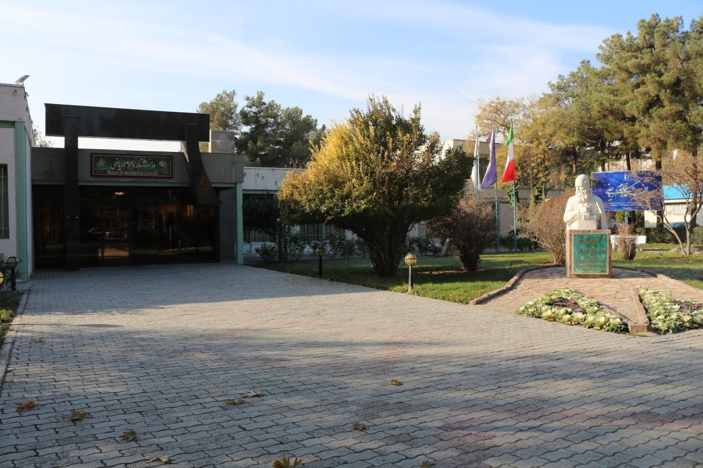
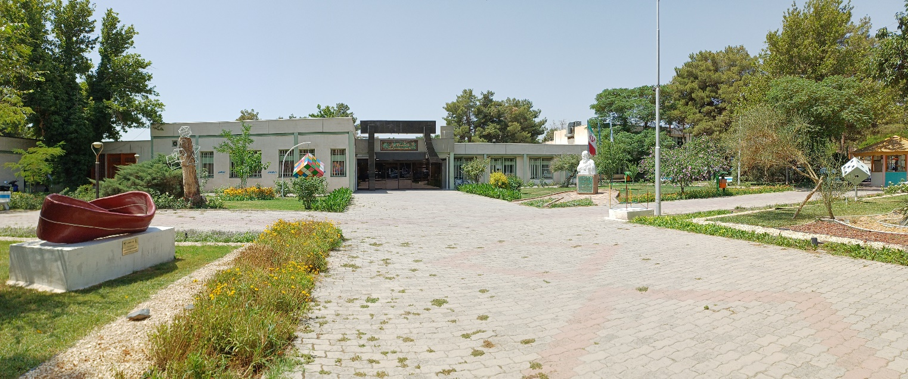
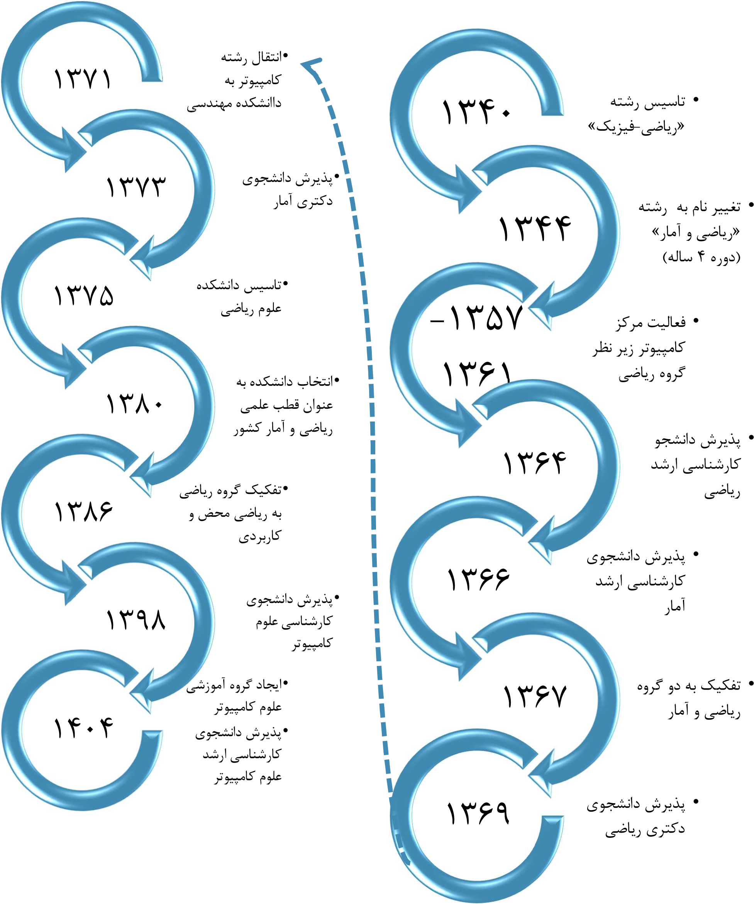

# تاریخچه دانشکده

گروه ریاضی یکی از قدیمی‌ترین گروه‌های آموزشی دانشگاه می‌باشد که در سال ۱۳۴۱ به همت استادانی چون دکتر اسماعیل بیگی (رئیس وقت دانشگاه مشهد) و دکتر محمدعلی سعادت (اولین رئیس دانشکده علوم) به عنوان اولین رشته در دانشکده علوم تحت عنوان «ریاضی – فیزیک» پایه‌ریزی گردید. گروه ریاضی تا سال ۱۳۴۳ به صورت دوره‌های سه ساله در رشته ریاضی-فیزیک دانشجو تربیت می‌کرد. در سال ۱۳۴۴ این رشته به «ریاضی و آمار» تغییر نام داد. دانشجویان طی یک دوره چهار ساله با درجه کارشناسی ریاضی فارغ‌التحصیل می‌شدند. در این دوران پروفسور تقی فاطمی در چندین دوره مدیریت گروه ریاضی را بر عهده داشتند. گروه ریاضی اولین گروه آموزشی دانشگاه فردوسی مشهد است که بعد از پیروزی انقلاب اسلامی ایران، دانشجوی دکتری پذیرفته است. دوره‌های کارشناسی ارشد ریاضی و آمار به ترتیب در سال‌های ۱۳۶۴ و ۱۳۶۶ و دوره‌های دکتری ریاضی و آمار به ترتیب در سال‌های ۱۳۶۹ و ۱۳۷۳ ایجاد شدند.

تأسیس دانشکده علوم ریاضی در سال ۱۳۷۵

با رشد گروه ریاضی، متعاقباً رشته آمار و ماشین‌های حسابگر در این گروه شروع به فعالیت نمود. از سال ۱۳۵۷ تا ۱۳۶۱ مرکز کامپیوتر دانشگاه نیز زیر نظر گروه ریاضی فعالیت داشت. این گروه آموزشی تا سال ۱۳۶۷ تحت نام «گروه ریاضی، آمار و کامپیوتر» به فعالیت خود ادامه داد. از این سال به بعد به دو گروه آموزشی ریاضی و آمار تفکیک شد. رشته کامپیوتر نیز تا چندین سال مشترکاً با گروه ریاضی فعالیت می‌نمود که در سال ۱۳۷۱ به دانشکده مهندسی منتقل گردید. با دوراندیشی اعضای هیأت علمی وقت و پیگیری دکتر محمدرضا رجب‌زاده مقدم (که طی حکمی از طرف رئیس وقت دانشگاه مسئول پیگیری تأسیس دانشکده علوم ریاضی شده بود)، بالاخره در سال ۱۳۷۵، وزارت علوم موافقت خود را با تأسیس دانشکده علوم ریاضی اعلام نمود و این دانشکده با تفکیک از دانشکده علوم پایه و با دو گروه آموزشی ریاضی و آمار و ۴۸ عضو هیأت علمی تأسیس شد.

گروه‌های آمار و ریاضی این دانشکده از سال ۱۳۸۰ تا کنون به ترتیب به عنوان قطب‌های علمی آمار و ریاضی کشور شناخته شده‌اند. گروه آموزشی ریاضی در سال تحصیلی ۱۳۸۶-۱۳۸۷ به دو گروه «ریاضی کاربردی» و «ریاضی محض» تقسیم گردید. در سال ۱۳۹۸، دوره کارشناسی علوم کامپیوتر و دوره کارشناسی ارشد گرایش ریاضیات زیستی تأسیس گردید.   در سال ۱۴۰۴ گروه ریاضی علوم کامپیوتر در دانشکده راه‌اندازی شد و همچنین در همین سال اولین دوره از دانشجویان کارشناسی ارشد علوم کامپیوتر پذیرش گردیدند.

دانشکده علوم ریاضی در راستای اهداف دانشگاه فردوسی مشهد و وزارت علوم، تحقیقات و فناوری در سه حوزه آموزش، پژوهش و کارآفرینی فعالیت دارد. این دانشکده به تربیت دانشجو در سه مقطع کارشناسی، کارشناسی ارشد و دکترا در چهار رشته اصلی ریاضی محض، ریاضی کاربردی، آمار و علوم کامپیوتر می‌پردازد.

