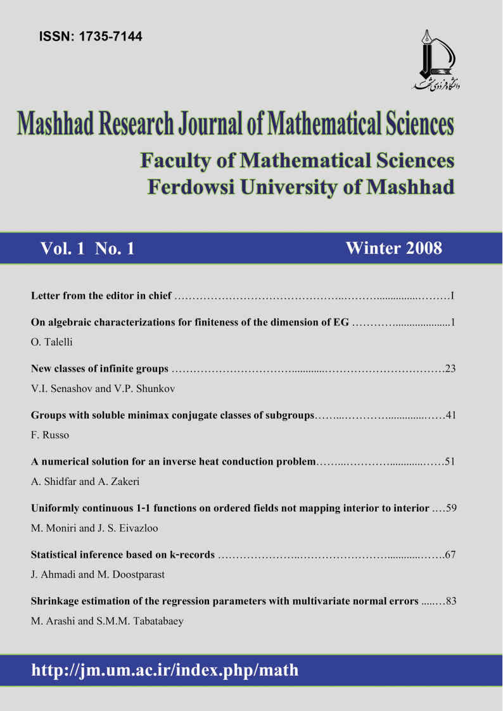
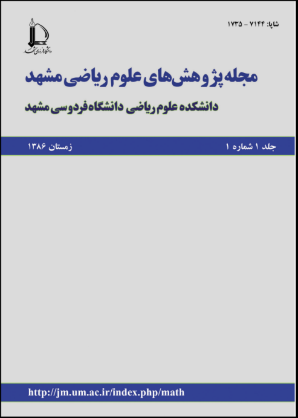
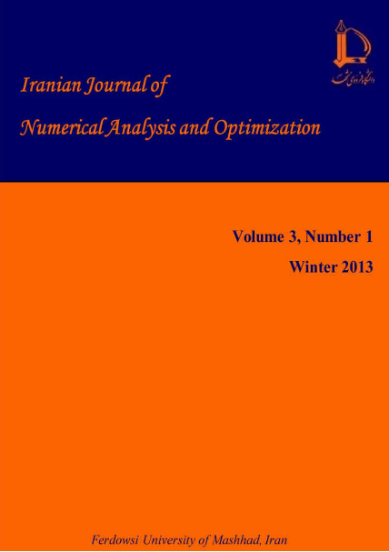
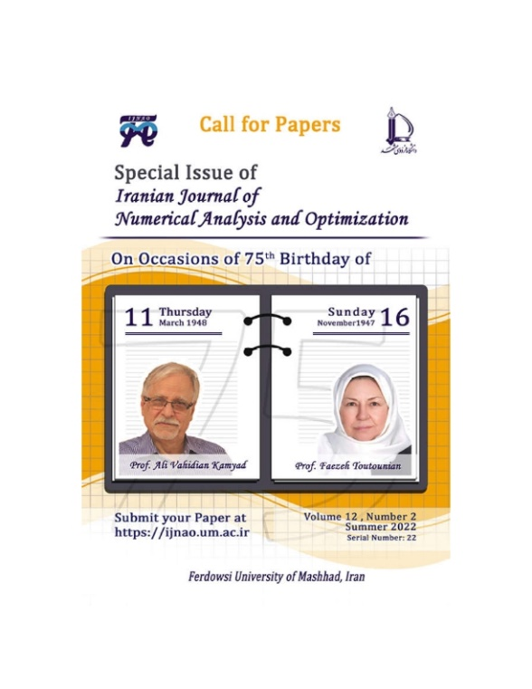
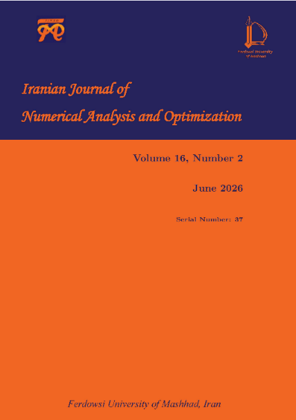
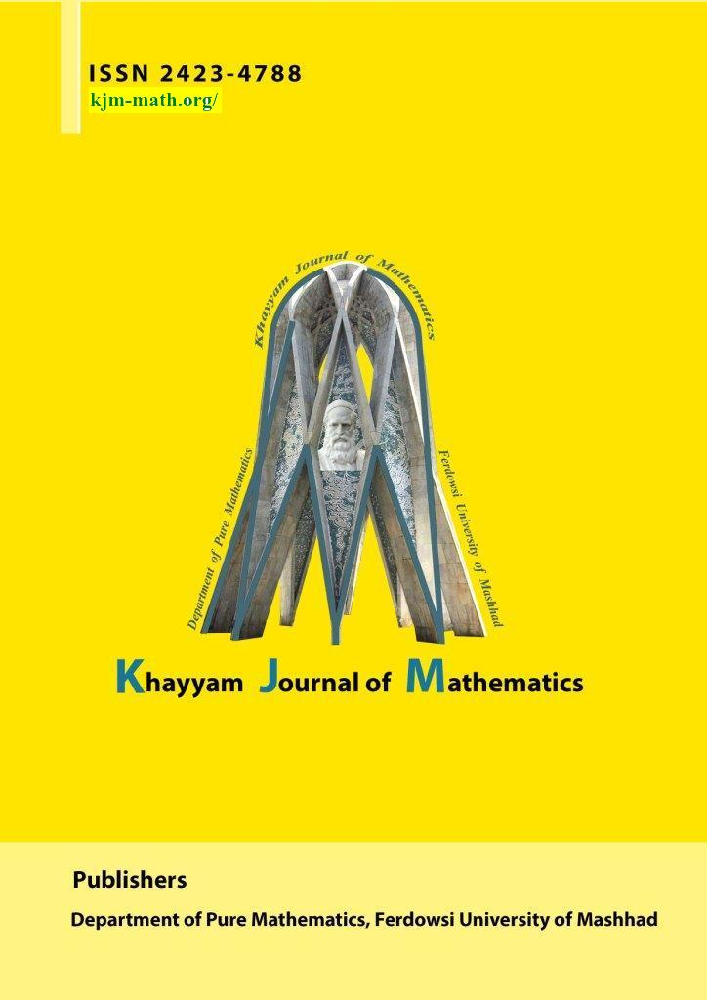
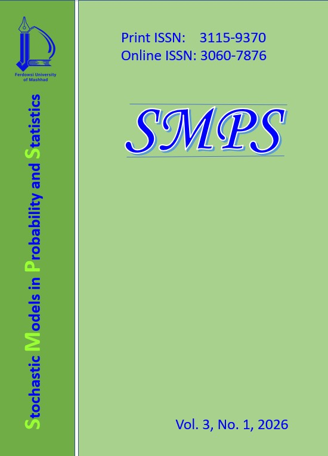
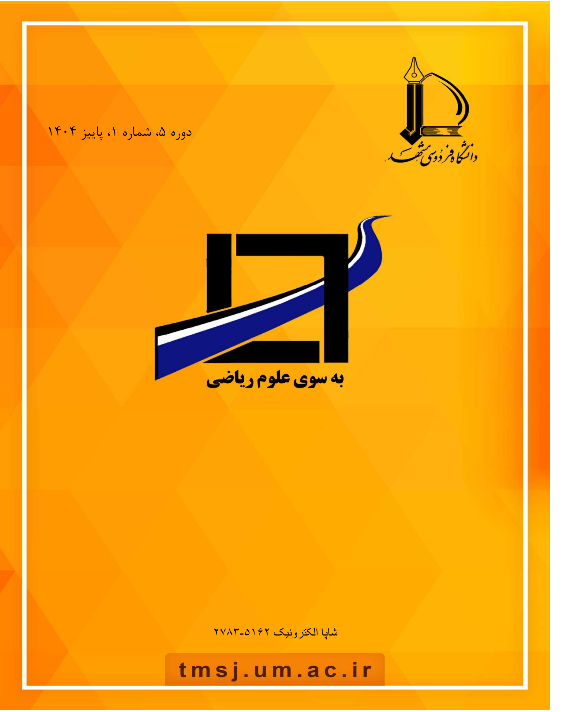

# مجلات

## مجله ایرانی آنالیز عددی و بهینه‌سازی

## Iranian Journal of Numerical Analysis and Optimization (IJNAO)

در جلسه هیأت  تحریریه مجله «علوم» مورخ ۴ اردیبهشت ۱۳۸۵، مصوب شد که دانشکده علوم ریاضی، مجله‌ای تخصصی با عنوان «مجله پژوهش‌های علوم ریاضی مشهد» منتشر کند تا از مجله علوم تفکیک شود. بدین منظور، دانشکده علوم ریاضی اقدام به انتخاب هیأت  تحریریه این مجله نمود. این مجله در سال‌های ۲۰۰۸ و ۲۰۰۹، به زبان انگلیسی و در دو نسخه، جمعاً با ۱۴ مقاله منتشر شد.

Mashhad Research Journal of Mathematical Sciences

Editor in Charge

H.R. Tareghian

Editor in Chief

M.R.R. Moghaddam

Managing Editor

H. Jabbari Nooghabi

در سال ۱۳۸۹ و در پی سیاست‌های جدید معاونت پژوهشی وزارت علوم، تحقیقات و فناوری مبنی بر تخصصی‌تر شدن مجلات دانشگاهی، دانشکده علوم ریاضی ناگزیر از تغییر و تحدید قلمرو فعالیت مجله مزبور گردید. این امر منجر به تغییر عنوان مجله، ترکیب هیأت  تحریریه و سردبیر شد. «مجله ایرانی آنالیز عددی و بهینه‌سازی» توسط گروه ریاضی کاربردی دانشکده علوم ریاضی با هدف گسترش دانش ریاضی در زمینه‌های آنالیز عددی و بهینه‌سازی، و نیز تعامل ملی و بین‌المللی با ریاضیدانان داخل و خارج از کشور راه‌اندازی شد.

این مجله از تاریخ ۲۵ دی ۱۳۹۲ به عنوان نشریه‌ای علمی-پژوهشی مورد تأیید وزارت متبوع به کار خود ادامه داده و موفق به کسب رتبه دوم نشریات دانشگاه فردوسی مشهد شده است (این امتیاز در سامانه ارزیابی نشریات علمی کشور قابل تأیید است). شایان ذکر است که این مجله در سال ۲۰۱۵ موفق به کسب امتیاز ۳‎EJCR از پایگاه ISC نیز گردید. در ادامه، در اردیبهشت ۱۳۹۹ برای نمایه‌سازی در Scopus پذیرفته شد و در سال ۲۰۲۱ موفق به کسب رتبه چارک چهارم (Q۴) در این پایگاه معتبر گردید.

Editor in Charge

H. R. Tareghian

Editor in Chief

M. H. Farahi

Managing Editor

M. Gachpazan

مجله در سال‌های ۲۰۱۳ تا ۲۰۲۱ به صورت دوماهنامه منتشر می‌شد. جلد ۱۲، شماره ۳، سال ۲۰۲۲، با اختصاص ویژه‌نامه‌ای به مناسبت هفتاد و پنجمین سالگرد تولد پروفسور آ. وحیدیان و پروفسور ف. توتونیان انتشار یافت.

از سال ۲۰۲۳، مجله به صورت فصلنامه و با ۶۰ مقاله در هر سال به چاپ می‌رسد. اکنون هیأت  تحریریه مجله متشکل از ۳۷ عضو است که ۷ نفر از آنان از اعضای هیأت  علمی دانشکده علوم ریاضی دانشگاه فردوسی مشهد و ۲۷ نفر دیگر از دانشگاه‌های داخل و خارج از کشور هستند. در سال ۲۰۲۵، این مجله موفق به ارتقا به چارک سوم (Q۳) در پایگاه Scopus شد. همچنین قطب علمی مدل‌سازی و کنترل دستگاه‌ها در دانشکده، از حامیان این مجله محسوب می‌شود.

این نشریه در پایگاه‌های اطلاعاتی زیر نمایه می‌شود

نسخه الکترونیکی مقالات در وب‌سایت نشریه به آدرس زیر قابل دسترسی است و سایر اطلاعات مجله نیز در این سایت قابل مشاهده می‌باشد:

https://ijnao.um.ac.ir

اعضای هیأت تحریریه مجله در سال‌های (۲۰۲۳-۲۰۲۶)

Director-in-Charge

Farahi, M. H. (Iran)

Editor-in-Chief

Soheili, Ali R. (Iran)

Managing Editor

Gachpazan, M. (Iran)

Language Editor:

Zohreh Vasagh

## مجله ریاضی خیام

## Khayyam Journal of Mathematics (KJM)

مجله بین‌المللی ریاضی خیام با دسترسی‌آزاد، داوری‌شده و کاملاً الکترونیکی است که از سال ۲۰۱۵ به انتشار مقالات پژوهشی بدیع و باکیفیت به زبان انگلیسی می‌پردازد. این مجله از ابتدای انتشار تا پایان سال ۲۰۲۵، با همکاری گروه پژوهشی ریاضی طوسی و قطب علمی آنالیز روی ساختارهای جبری و گروه ریاضی محض دانشکده علوم ریاضی دانشگاه فردوسی مشهد، فعالیت می‌کرد و از سال ۲۰۲۶، دانشگاه فردوسی مشهد به‌عنوان ناشر اصلی، مسئولیت انتشار آن را بر عهده گرفته است.

حوزه‌های موضوعی این مجله گسترده است و شامل آنالیز ریاضی، جبر (از جمله جبر جابجایی، جبر همولوژی و جبر خطی و چندخطی)، ترکیبیات، ترکیبیات جبری، نظریه گروه‌ها، گروه‌های توپولوژیک، هندسه، توپولوژی (شامل توپولوژی عمومی و جبری)، معادلات دیفرانسیل (معمولی و با مشتقات جزئی)، سیستم‌های دینامیکی، آنالیز هارمونیک انتزاعی، آنالیز تابعی و نظریه عملگرها می‌شود. مقالات این مجله با تأکید بر نتایج عمیق، ایده‌های نوین و تأثیرگذاری علمی قابل‌توجه، در قالب مقالات تحقیقاتی اصیل و گاه مقالات مروری به چاپ می‌رسند.

مجله خیام از نمایه‌های معتبر بین‌المللی چون Scopus، MathSciNet، DOAJ  و Zentralblatt MATH بهره می‌برد. بر اساس تازه‌ترین رتبه‌بندی SCImago Journal Rank – SJR  در سال ۲۰۲۴، این مجله با امتیاز ۰.۲۲۳ در رده چهارم (Q۴) از میان نشریات حوزه ریاضیات قرار دارد. شایان ذکر است که رتبه کیفی (Q-Rank) این مجله از سال ۲۰۱۹ تاکنون نوساناتی داشته و در سال‌های ۲۰۲۰، ۲۰۲۲، ۲۰۲۳ و ۲۰۲۴ در رده Q۴ قرار گرفته است.

نسخه الکترونیکی تمامی مقالات این مجله به‌صورت رایگان و بدون هزینه برای نویسندگان و خوانندگان، روی وب‌سایت رسمی نشریه به نشانی https://kjm.um.ac.ir/ در دسترس است و علاقه‌مندان می‌توانند برای کسب اطلاعات جامع درباره ضوابط انتشار، دوره‌های پیشین و آخرین اخبار، به این پایگاه اطلاعاتی مراجعه کنند. همچنین، این مجله از سال ۲۰۲۴، مدل انتشار مقاله‌ای پیوسته (CAP) را به کار گرفته است که طی آن مقالات پذیرفته‌شده بلافاصله پس از طی فرایند تولید، به‌صورت نهایی در یک شماره منتشر می‌شوند و این رویه، زمان کلی انتشار را به‌طور چشمگیری کاهش داده است.

اعضای هیأت تحریریه مجله از ابتدا تاکنون

Director-in-Charge:

Sal Moslehian, Mohammad (۲۰۱۵-۲۰۲۶)

Editor-in-Chief:

Ebrahimi Vishki, Hamid Reza (۲۰۱۵-۲۰۲۶)

Mashayekhy, Behrooz  (۲۰۱۵-۲۰۲۰)

Managing Editor:

Hejazian, Shirin  (۲۰۱۵-۲۰۲۳)

Mashayekhy, Behrooz (۲۰۲۳-۲۰۲۶)

Sections Editors:

Ghane, Fatemeh Helen (۲۰۲۰-۲۰۲۶)

Mashayekhy, Behrooz (۲۰۲۰-۲۰۲۳)

Hejazian, Shirin  (۲۰۲۳-۲۰۲۶)

Kamel Mirmostafaee, Alireza (۲۰۲۰-۲۰۲۶)

Language Editor:

Erfanian, Ahmad  (۲۰۱۵-۲۰۲۰)

Mirzavaziri, Madjid  (۲۰۱۵-۲۰۲۰)

Vasagh, Zohreh  (۲۰۲۰-۲۰۲۶)

Technical Editor:

Kamyabi-Gol, Rajab Ali  (۲۰۱۵-۲۰۲۰)

## مجله مدل‌های تصادفی در احتمال و آمار

## Stochastic Models in Probability and Statistics (SMPS)

از سال ۲۰۲۴ مجله SMPS با  هدف انتشار مقالات علمی-پژوهشی به زبان انگلیسی درحوزه‌های مدل‌های تصادفی در احتمال و آمار شروع به کار کرده است. محورهای پژوهشی آن با تأکید بر کاربردهای مدل های آمار و احتمال  در مسائل قابلیت اطمینان است.  SMPS    مقالات در موضوعات روش‌های ریاضی در قابلیت اطمینان، تحلیل داده‌های طول عمر، مدل‌های بیری و افزایش طول عمر، مدل‌سازی آماری در قابلیت اطمینان، روش‌های آماری در تحقیقات عملیاتی، مدل‌های تصادفی در مهندسی صنایع و سیستم‌ها، مدل‌سازی بهینه در نگهداری و تعمیرات، کنترل کیفیت و فرآیند نظارت، روش‌های ناپارامتری در تحلیل طول عمر، روش‌های آماری در نظریه اطلاعات، مدل‌های داده‌های ترتیبی و کاربردهای آنها، ترتیب های  تصادفی، قابلیت اطمینان نرم‌افزار، تحلیل داده‌ها در قابلیت اطمینان، روش‌های  مفصل و مدل‌سازی وابستگی، کلان داده و کاربردهای قابلیت اطمینان منتشر می‌کند.

اعضای هیأت تحریریه مجله

Director-in-Charge

Jafar Ahmadi (Iran)

Editor-in-Chief

Jafar Ahmadi (Iran)

Executive Editor

Mahdi Doostparast (Iran)

Managing Editor

Mostafa Razmkhah (Iran)

Technical Editor

Hadi Jabbari Nooghabi (Iran)

English Text Editor

Zohreh Vasagh (Iran)

## مجله به سوی علوم ریاضی

## Toward Mathematical Sciences

این نشریه علمی-ترویجی از سال ۱۴۰۰ به انتشار مقالات فارسی پرداخته است. مجله به سوی علوم ریاضی مقالات در زمینه‌های ریاضی محض، ریاضی کاربردی، آمار و احتمال، علوم کامپیوتر، آموزش ریاضی، تاریخ و فلسفه ریاضی، کاربردهای ریاضی، آمار و علوم کامپیوتر در سایر علوم، و نقدهای علمی را برای بررسی می پذیرد. همچنین ترجمه مقالاتی در موضوعات گفته شده نیز با شرایط خاص مورد بررسی قرار می گیرد.

مدیر مسئول

محمد صال مصلحیان

سردبیر

بهروز مشایخی فرد

مدیر اجرایی

محمد جانفدا

ویراستار

زهره وثاق
