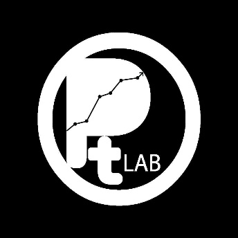
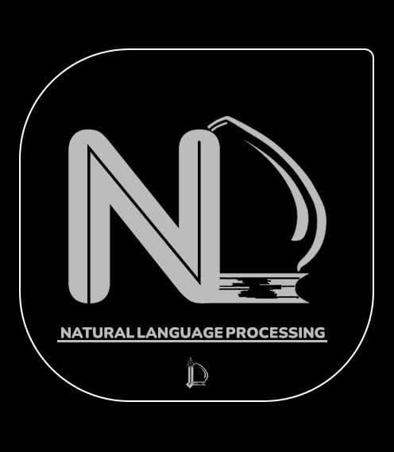
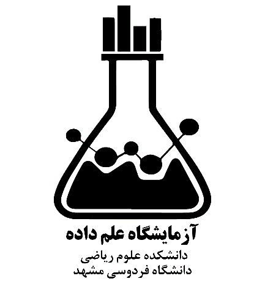
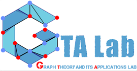

# آزمایشگاههای دانشکده

## آزمایشگاه بازی‌سازی

آزمایشگاه فناوری بازی‌سازی دانشکده علوم ریاضی در شهریورماه ۱۳۹۷ به همت دکتر رسول رمضانیان فعالیت خود را آغاز کرد. در دی‌ماه همان سال، ریاست بنیاد ملی بازی‌های رایانه‌ای از عملکرد آزمایشگاه بازدید به عمل آورد؛ بازدیدی که نشان‌دهنده جایگاه رو به رشد این آزمایشگاه در سطح ملی بود. از آن زمان تاکنون، دانشجویان این آزمایشگاه چندین بازی در حوزه بازی‌های رایانه‌ای کودکان طراحی و تولید کرده‌اند که در همایش‌های رسمی به نمایش گذاشته شده‌اند.

اهداف اصلی این آزمایشگاه عبارت‌اند از:

آماده‌سازی دانشجویان برای ورود و فعالیت در صنعت بازی‌سازی

انجام تحقیقات در حوزه بازی‌انگاری (Gamification) و راهکارهای کاربست آن

به‌کارگیری فرایندهای بازی‌محور در حوزه علوم انسانی

این آزمایشگاه به رایانه‌های مخصوص محاسبات سنگین مجهز است که بر روی آن‌ها نرم‌افزارها و ابزارهای تخصصی زیر نصب و راه‌اندازی شده‌اند:

Unity۳D

Node.js

Photoshop

After Effects

در خردادماه سال ۱۴۰۱ این ازمایشگاه به بلاکچین تغییر نام داد و لازم به ذکر است که فعالیت این آزمایشگاه، به دلیل عدم حضور مدیر مسئول آن و سپری کردن فرصت مطالعاتی ایشان، مدتی است متوقف شده و در انتظار از سرگیری مجدد است.

## آزمایشگاه بهینه‌سازی

امروزه علم بهینه‌سازی به‌عنوان یکی از ابزارهای کلیدی در مدل‌سازی، تحلیل داده‌ها و ارتقای کیفی نتایج عملی در حوزه‌های گوناگون علمی شناخته می‌شود. از مهندسی و مدیریت گرفته تا کشاورزی و علوم کامپیوتر، همه به دنبال یافتن بهترین پاسخ ممکن در میان انبوهی از گزینه‌ها هستند. در همین راستا، آزمایشگاه بهینه‌سازی دانشگاه فردوسی مشهد در سال ۱۳۹۶ با همت دکتر رضا قنبری، عضو هیأت علمی گروه ریاضی کاربردی، تأسیس شد تا پاسخی نظام‌مند به این نیاز روزافزون باشد.

هدف اصلی این آزمایشگاه، ایجاد پلی میان ریاضیات محض و کاربردهای واقعی آن است. در این مرکز، پژوهشگران با مدل‌سازی دقیق مسائل، حل مؤثر مدل‌ها و تحلیل حساسیت نتایج، بستری فراهم می‌آورند تا رشته‌های مختلف علمی و حتی شرکت‌ها و دستگاه‌های اجرایی بتوانند از ظرفیت‌های بهینه‌سازی بهره ببرند. ماهیت نرم‌افزاری آزمایشگاه نیز امکان تولید بسته‌های نرم‌افزاری تجاری و همچنین ابزارهای متن‌باز تحقیقاتی را فراهم کرده است.

یکی از سیاست‌های کلیدی آزمایشگاه، حمایت از جامعه علمی دانشگاه فردوسی است. به‌گونه‌ای که خدمات آن برای مخاطبان غیر علوم ریاضی با دریافت هزینه ارائه می‌شود، اما در بیشتر موارد، اعضای علوم ریاضی دانشگاه می‌توانند بدون هزینه از خدمات مشاوره‌ای، پیاده‌سازی مدل در نرم‌افزارهای تجاری، تحلیل مدل‌ها، طراحی الگوریتم‌های بهینه‌سازی و هوشمند، و حتی طراحی مدل‌های تجاری بهره‌مند شوند.

با توجه به نوپا بودن چنین آزمایشگاه‌هایی در کشور، دو چشم‌انداز برای آینده آن ترسیم شده است: در میان‌مدت، آزمایشگاه با تولید کدهای نرم‌افزاری و مدل‌سازی‌های گوناگون، نیازهای پژوهشی دانشجویان و اساتید رشته‌های مرتبط را در سطح دانشگاه پاسخ می‌دهد و همزمان، به دانشجویان شاغل در آزمایشگاه، تجربه ارزشمند عملی در محاسبات می‌آموزد. در درازمدت، با تجمیع تخصص‌های گوناگون، این مرکز به دروازه ارتباط تخصصی با جامعه منطقه‌ای و ملی تبدیل خواهد شد و زمینه شکل‌گیری استارتاپ‌هایی برای حل مسائل بهینه‌سازی را فراهم می‌آورد.

زیرساخت‌های آزمایشگاه شامل یک رایانه قدرتمند برای محاسبات سنگین و چندین سیستم دیگر برای اجرای پروژه‌های بهینه‌سازی است. تاکنون فعالیت‌های ارزشمندی در این مرکز انجام شده که از آن جمله می‌توان به پروژه سامانه حمل‌ونقل هوشمند (VRP)، طراحی سامانه بهره‌وری آب کشاورزی (سیاب) برای استان‌های خراسان شمالی و خوزستان با دو رویکرد متفاوت بهینه‌سازی ریاضی (در همکاری با شرکت هیدروتک)، همکاری مشاوره‌ای با دانشگاه‌های سمنان و شریف در زمینه الگوریتم‌های فراابتکاری، و انجام پژوهش‌های مشترک با دانشکده‌های مهندسی کامپیوتر، مدیریت و کشاورزی دانشگاه فردوسی اشاره کرد که حاصل آن، ارسال مقالات متعدد به ژورنال‌های معتبر بوده است. افزون بر این، کلاس‌های آموزشی برنامه‌نویسی برای دانشجویان مستعد دانشکده برگزار می‌شود تا نسل جدیدی از متخصصان بهینه‌سازی پرورش یابند.

علاقه‌مندان برای آگاهی از پروژه‌های انجام‌شده و ارتباط با اعضای آزمایشگاه می‌توانند به وبسایت رسمی آن به آدرس http://optlab.um.ac.ir مراجعه کنند..

## آزمایشگاه پردازش زبان طبیعی

آزمایشگاه پردازش زبان طبیعی در آذرماه سال ۱۴۰۲ در دانشکده علوم ریاضی دانشگاه فردوسی مشهد تأسیس شد. این آزمایشگاه با هدف توسعه پژوهش‌های علمی و کاربردی در حوزه تحلیل داده‌های متنی، پردازش زبان طبیعی و مدل‌های زبانی نوین فعالیت خود را آغاز نمود و در ادامه تجربیات و فعالیت‌های پژوهشی انجام‌شده در حوزه متن‌کاوی و یادگیری ماشین، به‌ویژه در همکاری‌های پیشین مرتبط با پژوهشگاه علوم و فناوری اطلاعات ایران (ایرانداک)، شکل گرفت.

مأموریت اصلی آزمایشگاه، توسعه دانش و کاربردهای پردازش زبان طبیعی و تحلیل داده‌های متنی در مسائل علمی، صنعتی و سازمانی است. حوزه‌های کلیدی فعالیت آن شامل مدل‌های زبانی بزرگ و سامانه‌های مولد متن، سامانه‌های پرسش و پاسخ و تولید مبتنی بر بازیابی اطلاعات (RAG)، متن‌کاوی و استخراج اطلاعات، تحلیل داده‌های متنی و داده‌کاوی علمی، و همچنین توسعه کاربردهای این فناوری در حوزه‌های سلامت، آموزش و خدمات سازمانی می‌شود.

مدیریت و راهبری علمی و اجرایی آزمایشگاه از زمان تأسیس تاکنون بر عهده دکتر جلال‌الدین نصیری، عضو هیأت علمی دانشکده علوم ریاضی، بوده است. دکتر محمد آرشی نیز به‌عنوان همکار علمی در حوزه‌های پژوهشی و توسعه سامانه‌های پردازش زبان طبیعی با آزمایشگاه همکاری دارد. افزون بر این، دانشجویان تحصیلات تکمیلی و پژوهشگران همکار در قالب پروژه‌ها و پایان‌نامه‌های تخصصی در فعالیت‌های آزمایشگاه مشارکت می‌کنند.

آزمایشگاه از زیرساخت‌های پیشرفته‌ای برای پژوهش، آموزش و توسعه سامانه‌های مبتنی بر پردازش زبان طبیعی برخوردار است. مهم‌ترین امکانات آن شامل سامانه مجهز به پردازنده گرافیکی Nvidia RTX ۴۰۹۰ برای آموزش و استقرار مدل‌های زبانی، بستر اجرای محلی مدل‌های بزرگ با هدف حفظ امنیت اطلاعات، و دسترسی به ابزارها و چارچوب‌های تخصصی متن‌کاوی و تحلیل داده‌های متنی است.

از زمان تأسیس، آزمایشگاه در اجرای پروژه‌های پژوهشی و کاربردی متعددی مشارکت داشته است. از جمله پروژه طراحی و توسعه دستیار هوشمند پشتیبانی سازمانی با همکاری شرکت دانش‌بنیان رایانش ابری فردوسی که به طراحی سامانه پاسخ‌گویی خودکار مبتنی بر مدل‌های زبانی بزرگ و معماری RAG انجامیده است. همچنین تفاهم‌نامه همکاری برای توسعه دستیار هوشمند میز خدمت بیمارستان قائم (عج) در فاز نخست، با هدف پاسخ‌گویی خودکار به پرسش‌های مراجعان و حفظ امنیت داده‌های درمانی، از دیگر پروژه‌های شاخص به شمار می‌رود. مشارکت در طرح‌های پژوهشی بنیاد ملی علم ایران (INSF) در حوزه پردازش زبان طبیعی نیز بخشی از فعالیت‌های این مرکز است.

در کنار پروژه‌های کاربردی، آزمایشگاه به هدایت پایان‌نامه‌ها و پروژه‌های دانشجویی، توسعه نمونه‌های آزمایشی سامانه‌های گفتگوگر و پاسخ‌گویی مبتنی بر اسناد، و انتشار مقالات علمی در حوزه داده‌کاوی و پردازش زبان طبیعی پرداخته است. ارتباطات علمی با پژوهشگران دانشگاه صنعتی شریف و دانشگاه بن آلمان، گسترش فعالیت‌ها در راستای تحولات مدل‌های زبانی بزرگ، و توسعه زیرساخت‌های پژوهشی از دیگر اقدامات این آزمایشگاه به شمار می‌رود.

رویکرد اصلی آزمایشگاه، تمرکز بر حل مسائل واقعی و توسعه کاربردهای عملی پردازش زبان طبیعی در سازمان‌ها و صنایع مختلف است. همکاری با مراکز درمانی، شرکت‌های فناور و گروه‌های پژوهشی دانشگاهی موجب شده است فعالیت‌های آزمایشگاه علاوه بر جنبه‌های علمی، در مسیر توسعه راهکارهای کاربردی و پاسخ‌گویی به نیازهای واقعی جامعه نیز قرار گیرد.

آزمایشگاه پردازش زبان طبیعی در مدت کوتاه فعالیت خود توانسته است به عنوان یکی از هسته‌های فعال پژوهشی دانشکده علوم ریاضی در حوزه فناوری‌های زبانی و تحلیل داده‌های متنی شناخته شود و زمینه مناسبی برای انجام پژوهش‌های میان‌رشته‌ای، تربیت دانشجویان متخصص و توسعه همکاری‌های علمی و صنعتی فراهم آورد.

## آزمایشگاه علم داده‌ها

آزمایشگاه علم داده دانشکده علوم ریاضی دانشگاه فردوسی مشهد (DSLab) به‌عنوان یکی از نخستین گروه‌های تحقیقاتی میان‌رشته‌ای در حوزه داده‌کاوی و یادگیری ماشین در شرق کشور، در اردیبهشت‌ماه ۱۴۰۰ فعالیت رسمی خود را آغاز کرد. ایده تأسیس این آزمایشگاه، ریشه در نیاز روزافزون به تحلیل داده‌های خام و تبدیل آن‌ها به بینش کاربردی در مسائل واقعی جامعه داشت؛ نیازی که با گسترش داده‌های کلان در حوزه‌های شهری، صنعتی، اقتصادی و علمی بیش از پیش احساس می‌شد.

پیش‌زمینه شکل‌گیری DSLab به سیاست‌های دانشکده علوم ریاضی برای راه‌اندازی رشته‌های تقاضا‌محور بازمی‌گردد. از همین رو، دانشکده با هدف پرورش نیروی انسانی متخصص در علم داده و ایجاد پل ارتباطی میان دانشگاه و نهادهای اجرایی، اقدام به تأسیس این آزمایشگاه کرد. گروه هدف اولیه، دانشجویان و پژوهشگرانی بودند که در زمینه‌های آمار، ریاضیات کاربردی و علوم کامپیوتر به مدل‌سازی پدیده‌های دارای عدم‌قطعیت علاقه داشتند.

مراسم افتتاحیه آزمایشگاه در روز دوشنبه ۲۱ اردیبهشت‌ماه ۱۴۰۰، همزمان با هفته سرآمدی آموزش، به‌صورت ترکیبی (حضوری و مجازی) برگزار شد. در این رویداد، دکتر سهیلی، رئیس وقت دانشکده، از راه‌اندازی رشته علم داده در مقطع کارشناسی ارشد خبر داد و بر مشارکت DSLab با رصدخانه شهری شهرداری مشهد تأکید کرد. سپس دکتر محمد آرشی، مسئول راه‌اندازی آزمایشگاه، اهداف کلان را شامل حل مسائل واقعی جامعه، توسعه ابزارهای محاسباتی مبتنی بر روش‌های آماری، تهیه پایگاه‌های داده تخصصی، تربیت نیروی متخصص، و اجرای پروژه‌های اجتماعی، صنعتی و اقتصادی برشمرد. در ادامه، از وبسایت رسمی آزمایشگاه به آدرس http://dslab.um.ac.ir رونمایی شد.

در بخش علمی مراسم، دکتر مظلوم، پژوهشگر پسادکتری علم داده از دانشگاه آمستردام، به بیان چگونگی شکل‌گیری علم داده در سال ۲۰۱۳ بر اثر سه انفجار بزرگ در تولید داده‌های کلان، سخت‌افزار و یادگیری عمیق پرداخت و بر لزوم ارتباط آزمایشگاه با صنایع خودروسازی، نفت، فولاد و نهادهایی مانند شهرداری و پلیس تأکید کرد. افتتاحیه با حضور هیأت رئیسه، جمعی از اساتید و مدیرانی از شهرداری مشهد و مرکز نوآوری شهری به پایان رسید.

ساختار آزمایشگاه از ابتدا به‌گونه‌ای طراحی شد که هم از ظرفیت علمی اعضای هیأت علمی (در گروه‌های آمار، ریاضی کاربردی و علوم کامپیوتر) و هم از توان دانشجویان علاقه‌مند بهره گیرد. شورای راهبری اصلی با حضور اساتید و محققان بین‌المللی و شورای راهبری دانشجویی برای برنامه‌ریزی فعالیت‌ها، وبسایت و رسانه‌های اجتماعی تشکیل گردید. همچنین همکاران غیرمقیم از دانشگاه‌های تهران، یزد و نیشابور و مشاورانی از کانادا و پرتغال، اعتبار علمی آزمایشگاه را افزایش دادند.

از ابتدای تأسیس، DSLab با برگزاری کارگاه‌ها، سخنرانی‌های تخصصی و جلسات منظم علمی، فعالیت خود را آغاز کرد. وبسایت دوزبانه (فارسی-انگلیسی)، حضور در شبکه لینکداین و بخش درخواست همکاری، از اقدامات اولیه برای بین‌المللی‌سازی و جذب نیرو بود. همچنین در ارزیابی اولیه نسبت به همتایان داخلی (مانند آزمایشگاه‌های دانشگاه تهران، شریف و صنعتی امیرکبیر) و خارجی (همچون MIT، EPFL و دانشگاه کپنهاگ)، نقاط قوتی مانند شورای دانشجویی، شفافیت برنامه‌ها و همکاری چندرشته‌ای شناسایی شد.

با گذشت زمان، پیشنهادهایی برای بهبود گرافیک وبسایت، نمایش دستاوردها، ایجاد بخش‌های خدماتی، همکاری با گروه‌های علوم انسانی و مهندسی، برگزاری کارگاه‌های آشنایی با داده‌کاوی در مدارس، و تقویت ارتباط با صنعت مطرح گردید. هدف نهایی، تبدیل DSLab به مرکزی پیشرو در تحلیل داده و حل مسائل کلان‌شهری و صنعتی با رویکردی علمی، آموزشی و کاربردی است. امروزه این آزمایشگاه به‌عنوان یکی از قطب‌های نوپای علم داده در کشور، مسیر رشد و گسترش همکاری‌های ملی و بین‌المللی را دنبال می‌کند.

## آزمایشگاه قابلیت اعتماد محاسباتی

در دنیای صنعتی امروز، اعتماد مشتریان به محصولات و کیفیت خدمات پس از فروش، یکی از ارکان اصلی موفقیت و بقا در بازارهای رقابتی به شمار می‌رود. صنایع پیشرو همواره به دنبال روش‌هایی علمی برای افزایش بهره‌وری، کاهش هزینه‌ها و بهبود فرآیندهای تولیدی خود هستند. در این میان، تحلیل عددی قابلیت اعتماد سیستم‌ها و تهیه برنامه‌های بهینه نگهداری و تعمیرات، نقشی کلیدی ایفا می‌کند. بر این اساس، آزمایشگاه قابلیت اعتماد محاسباتی در پانزدهم آبان‌ماه سال ۱۴۰۳ در دانشکده علوم ریاضی دانشگاه فردوسی مشهد تأسیس شد تا پاسخی علمی و عملی به این نیاز اساسی صنایع کشور باشد.

مأموریت اصلی این آزمایشگاه، بر خلاف بسیاری از مراکز دانشگاهی که بر آموزش و پژوهش متمرکز هستند، به‌طور ویژه بر اجرای طرح‌های برون‌دانشگاهی و ارائه خدمات تخصصی به صنایع و سازمان‌های دولتی و غیردولتی متمرکز است. در واقع، آزمایشگاه قابلیت اعتماد محاسباتی با هدف پر کردن شکاف میان دانش نظری و نیازهای عینی صنعت پا به عرصه وجود نهاد و تلاش می‌کند تا با بهره‌گیری از روش‌های نوین آماری و تحلیل داده‌های طول عمر و فرسودگی، به افزایش کیفیت و کاهش ریسک‌های تولیدی کمک نماید.

حوزه‌های فعالیت این آزمایشگاه طیف گسترده‌ای از خدمات تخصصی را در بر می‌گیرد: ارزیابی عددی قابلیت اعتماد سیستم‌های مهندسی در صنایع گوناگون، تحلیل داده‌های طول عمر و فرسودگی با استفاده از روش‌های آماری پیشرفته، برنامه‌ریزی نگهداری و تعمیرات مبتنی بر شاخص‌های قابلیت اعتماد، و ارائه مشاوره به مجریان طرح‌های برون‌دانشگاهی. افزون بر این، اجرای مستقیم طرح‌های کاربردی در همکاری با صنایع خودروسازی، نفت، فولاد و سایر بخش‌های تولیدی و خدماتی، از دیگر اهداف کلیدی این مرکز به شمار می‌رود.

مدیریت علمی و اجرایی آزمایشگاه از زمان تأسیس تاکنون بر عهده دکتر مهدی دوست‌پرست، استاد برجسته گروه آمار دانشگاه فردوسی مشهد، بوده است. ایشان با بهره‌گیری از تجربیات ارزشمند خود در حوزه قابلیت اعتماد و آمار صنعتی، مسیر رشد و توسعه این مرکز را هدایت می‌کنند. در کنار ایشان، جمعی از اساتید برجسته و پژوهشگران مطرح کشور، از جمله دکتر جعفر احمدی، دکتر عبدالحمید رضائی‌رکن‌آبادی، دکتر مجید اسدی از دانشگاه اصفهان، دکتر محمد خنجری صادق، دکتر مصطفی رزمخواه، دکتر آرزو حبیبی‌راد و دکتر فرهاد کلاهان، به‌عنوان اعضای اصلی و همکاران علمی، آزمایشگاه را در دستیابی به اهداف خود یاری می‌رسانند. این ترکیب ارزشمند از تخصص‌های گوناگون در حوزه آمار و قابلیت اعتماد، بستری مناسب برای انجام پروژه‌های پیچیده و کاربردی فراهم آورده است.

آزمایشگاه قابلیت اعتماد محاسباتی با رویکردی مسئله‌محور و نتیجه‌گرا، در نظر دارد تا با ارائه خدمات مشاوره‌ای و اجرایی به صنایع مختلف، به مرجعی معتبر در حوزه ارزیابی قابلیت اعتماد و نگهداری و تعمیرات در کشور تبدیل شود. با توجه به ساختار مأموریت‌گرای این مرکز و بهره‌مندی از توان علمی اساتید مجرب، انتظار می‌رود که در مدت کوتاهی، گام‌های مؤثری در جهت افزایش بهره‌وری، کاهش هزینه‌های تولید و بهبود کیفیت محصولات صنایع کشور برداشته شود و زمینه برای ارتباط هرچه بیشتر دانشگاه با جامعه و صنعت فراهم آید.

## آزمایشگاه کنترل و هوش مصنوعی

آزمایشگاه کنترل و هوش مصنوعی (CAILab) در دانشکده علوم ریاضی دانشگاه فردوسی مشهد با مسئولیت دکتر سهراب عفتی در آذر ماه سال ۱۴۰۲، با هدف پیوند دادن مباحث نظری کنترل با رویکردهای نوین هوش مصنوعی شکل گرفت. در ابتدا، تمرکز اصلی این آزمایشگاه بر مباحث پایه‌ای کنترل تطبیقی و سیستم‌های دینامیکی بود، اما با گذر زمان و تجهیز تدریجی به رایانه‌های قدرتمند و ابزارهای تحقیقاتی تخصصی، دامنه فعالیت آن به سوی حوزه‌هایی نوین‌تر همچون یادگیری ماشین، شبکه‌های عصبی و مدل‌سازی هوش مصنوعی گسترش یافت.

این تحول تدریجی، آزمایشگاه را به جایگاهی رساند که بتواند پژوهش‌های خود را از فضای صرفاً نظری به سوی کاربردهای صنعتی واقعی هدایت کند. از جمله این مسیرها، همکاری در تحلیل و بهینه‌سازی سیستم‌های کنترلی در حوزه‌هایی متنوع چون پزشکی، صنایع معدنی (نمونه آن همکاری با معدن گل‌گهر سیرجان) و صنایع انرژی بوده است؛ پروژه‌هایی که نشان‌دهنده گسترش تعامل آزمایشگاه با صنایع مختلف کشور در طول سال‌های فعالیت آن است.

## آزمایشگاه نظریه گراف و کاربردهای آن

آزمایشگاه نظریه گراف و کاربردهای آن، به‌عنوان یکی از آزمایشگاه‌های تخصصی دانشکده علوم ریاضی دانشگاه فردوسی مشهد، با هدفی روشن پا به عرصه وجود نهاد: پیوند دادن مفاهیم عمیق و انتزاعی نظریه گراف با مسائل عینی و کاربردی دنیای واقعی. از همان بدو تاسیس در مرداد ماه  ۱۴۰۳، مسئولیت علمی این آزمایشگاه بر عهده دو پژوهشگر برجسته، دکتر مصطفی توکلی و دکتر محمود امین‌طوسی، قرار گرفت. این دو استاد با دوراندیشی، مسیر آزمایشگاه را از مبانی پایه‌ای نظریه گراف فراتر بردند و آن را به سوی حوزه‌های نوینی چون یادگیری عمیق گرافی و تحلیل شبکه‌های پیچیده سوق دادند.

گذر زمان، آزمایشگاه را به تدریج به امکانات محاسباتی پیشرفته‌ای مجهز کرد که از جمله آنها می‌توان به کارت گرافیکی قدرتمند RTX ۳۰۹۰ اشاره کرد. بهره‌گیری از چارچوب‌های پیشروی یادگیری عمیق مانند PyTorch و TensorFlow، افق پژوهش‌های آزمایشگاه را به طرز چشمگیری گسترش داد و امکان ورود به عرصه‌های کاربردی‌تری چون تحلیل شبکه‌های اجتماعی، پیش‌بینی الگوهای ترافیک شهری و حتی مدل‌سازی خواص پیچیده مولکولی را فراهم آورد. این توسعه فنی، همزمان با شکل‌گیری همکاری‌های ارزشمند علمی با دانشگاه‌های معتبر بین‌المللی نظیر دانشگاه ماریبور در اسلوونی و دانشگاه ژوهانسبورگ در آفریقای جنوبی، و نیز همکاری با دانشگاه صنعتی خواجه نصیرالدین طوسی در داخل کشور همراه شد. این تعاملات، فصل تازه‌ای در فعالیت‌های بین‌المللی آزمایشگاه گشود و بستری برای اجرای پروژه‌های مشترک و انتقال فناوری‌های نوین پدید آورد.

ثمره این مسیر پژوهشی پربار، در قالب تألیف چندین کتاب تخصصی به ثمر نشسته است. از جمله می‌توان به کتاب «الگوریتم‌های گراف: از نظریه تا پیاده‌سازی» که در سال ۱۴۰۴ منتشر شد، و پیش از آن کتاب‌های «عملیات گراف و کاربردهای آن در شیمی ریاضی» و «نظریه گراف و کاربردهای آن» اشاره کرد که هم‌اکنون در کتابخانه دانشکده علوم ریاضی در دسترس دانشجویان و پژوهشگران قرار دارد. این روند پویای پژوهشی در سال‌های اخیر با انتشار مقالات متعدد در نشریات بین‌المللی معتبری همچون Soft Computing، Iranian Journal of Mathematical Chemistry، و IEEE Transactions on Pattern Analysis and Machine Intelligence تداوم یافته و اعتبار علمی اعضای آزمایشگاه را به سطحی رسانده است که داوری مقالات برای این مجلات برجسته به آن‌ها سپرده می‌شود.

آزمایشگاه، علاوه بر فعالیت‌های پژوهشی، همواره به ارتباط با جامعه دانشجویی نیز توجه داشته است. برگزاری کارگاه‌های آموزشی و ترویجی، از جمله کارگاه جذاب «مکالمه با چت‌بات‌ها» در آبان‌ماه ۱۴۰۴، نمونه‌ای از این دغدغه آموزشی است. اکنون این آزمایشگاه در آستانه گامی جدید قرار دارد و با برنامه‌ریزی برای تقویت چشمگیر زیرساخت‌های محاسباتی خود - از جمله افزایش حافظه، ارتقای قطعات سخت‌افزاری و تأمین کارت‌های گرافیکی پیشرفته برای یادگیری عمیق - در پی فراهم کردن بستری توانمندتر برای پروژه‌های پژوهشی آینده است.
