# کنفرانس‌ها و سمینارها

| عنوان کنفرانس | زمان برگزاری |
|---|---|
| اولین سمینار آنالیز ریاضی و کاربردهای آن | ۱۳۵۷ |
| یازدهمین کنفرانس ریاضی ایران | ۸ تا ۱۱ فروردین‌۱۳۵۹ |
| چهارمین سمینار جبر کشور | شهریور ۱۳۶۷ |
| بیست و دومین کنفرانس ریاضی ایران | ۲۲ تا ۲۵ اسفند ۱۳۶۹ |
| دومین کنفرانس آمار ایران | ۱۳۷۳ |
| هفتمین سمینار آنالیز ریاضی و کاربردهای آن | آبان ۱۳۷۴ |
| چهارمین کارگاه C*  - جبر (C* - مدولهای هیلبرت ) | ۱۷  تا ۱۸ آذر ۱۳۷۴ |
| اولین کنفرانس بهینه سازی و کاربردهای آن | ۲۶ تا ۲۸ آذر ۱۳۷۷ |
| چهارمین سمینار معادلات دیفرانسیل، سیستم های دینامیکی . کاربردهای آن و بزرگداشت پروفسور تقی فاطمی | ۱۴ تا ۱۵ اردیبهشت ۱۳۷۹ |
| پنجمین کنفرانس آموزش ریاضی | بهمن ۱۳۷۹ |
| نخستین کارگاه C*  - جبر | شهریور ۱۳۸۱ |
| سی و سومین کنفرانس ریاضی ایران | ۸ تا ۱۱ شهریور ۱۳۸۱ |
| دومین کارگاه پیوستگی خود به خود | ۱۸ و ۱۹ تیر ۱۳۸۲ |
| کارگاه موجکها و کاربردهای آن | ۲ تا ۳ اسفند ۱۳۸۵ |
| کارگاه آموزشی ساختارهای جبری | ۱۶تا ۱۷ شهریور ۱۳۸۵ |
| شانزدهمین سمینار آنالیز ریاضی و کاربردهای آن | ۱۵ و ۱۶ بهمن ۱۳۸۵ |
| کارگاه سیستمهای دینامیکی و نظریه آشوب | ۱۵ تا ۱۶ شهریور ۱۳۸۶ |
| کارگاه آموزشی آشنایی با ریاضیات و منطق فازی و کاربردهای آن | شهریور ۱۳۸۶ |
| اولین کنگره مشترک سیستم های فازی و سیستم های هوشمند (دانشکده علوم ریاضی و دانشکده مهندسی دانشگاه فردوسی مشهد) | ۷تا۹ شهریور ۱۳۸۶ |
| اولین همایش کاربرد ریاضیات و نظریه کنترل در پزشکی | ۲۲ اسفند ۱۳۸۶ |
| کارگاه توپولوژی جبری | ۲۴تا۲۶ آذر ۱۳۸۷ |
| سه کارگاه نامساویها در فضاهای باناخ، آنالیز هارمونیک و موجک، عملگرهای فردهولم | ۴ تا ۶ دی‌ ۱۳۸۷ |
| کارگاه آموزشی سیستم های دینامیکی و نظریه ارگودیک | ۱۵ تا ۲۰ فروردین ۱۳۸۸ |
| دومین همایش کاربرد ریاضیات و نظریه کنترل پزشکی | ۹ تا ۱۰ دی‌ ۱۳۸۸ |
| دومین کنفرانس نظریه گروه‌ها | ۱۹ تا ۲۱اسفند ۱۳۸۸ |
| دومین همایش ترکیبیات جبری ایران | ۱۳۸۹ |
| نهمین سمینار جبرجابجایی | ۱۳۹۱ |
| چهل و چهارمین کنفرانس ریاضی | ۸تا ۱۱ شهریور۱۳۹۲ |
| هفتمین سمینار جبر خطی و کاربردهای آن | اسفند ۱۳۹۲ |
| اولین سمینار فلسفه علم | خرداد۱۳۹۳ |
| هفتمین همایش ترکیبیات جبری ایران | ۱۳۹۳ |
| سومین کنفرانس بین‌المللی دوسالانه نظریه گروه‌ها | ۱۳۹۳ |
| هفتمین کنفرانس نظریه گروه‌های ایران، | ۸ تا ۱۱ بهمن ۱۳۹۳ |
| سومین کارگاه سیستمهای دینامیکی و نظریه ارگودیک | آذر ۱۳۹۴ |
| کارگاه maple | ۱۳۹۴ |
| کارگاه با عنوان  Random Walks on Groups and Poisson Boundaries | ۹ دی‌ ۱۳۹۴ |
| چهارمین سمینار آنالیز تابعی و کاربردهای آن | اسفند ۱۳۹۴ |
| چهارمین کارگاه سیستمهای دینامیکی و نظریه ارگودیک | اسفند ۱۳۹۴ |
| هشتمین کنفرانس بین‌المللی تحقیق در عملیات | اردیبهشت  ۱۳۹۴ |
| دومین سمینار فلسفه علم | آذر ۱۳۹۴ |
| پنجمین سمینار آنالیز هارمونیک و کاربردهای آن | ۲۹ تا ۳۰ دی ۱۳۹۵ |
| سومین سمینار نظریه عملگرها و کاربردهای آن | ۱۸ و ۱۹ اسفند ۱۳۹۵ |
| سومین سمینار فلسفه علم | اسفند ۱۳۹۵ |
| سومین کارگاه ریاضی نویسی و مقاله نویسی | آذر ۱۳۹۵ |
| کارگاه آموزشی فنون مقاله نویسی | ۴ آذر ۱۳۹۵ |
| کارگاه آموزشی انشعاب و آشوب: مدلسازی و کاربردی | ۷ و ۸ خرداد ۱۳۹۵ |
| کارگاه علمی- آموزشی پروتکل های ارتباطی | ۴ و ۵ مهر ۱۳۹۵ |
| سومین سمینار نظریه عملگرها و کاربردهای آن | ۱۸ تا ۱۹ اسفند ۱۳۹۵ |
| کارگاه آموزشی نظریه گراف و کاربردهای آن | ۲۷ اردیبهشت ۱۳۹۶ |
| سومین سمینار نظریه قابلیت اعتماد و کاربردهای آن | ۲۶ و ۲۷ اردیبهشت‌ ۱۳۹۶ |
| اولین سمینار کنترل و بهینه سازی | ۱۹ تا ۲۰ مهر ۱۳۹۶ |
| سومین کارگاه اندازه‌های اطلاعات و کاربردهای آن | اسفند ۱۳۹۶ |
| هشتمین سمینار آمار و احتمال فازی  با بزرگداشت یاد استاد فقید پروفسور ناصررضا ارقامی | ۱۹ اردیبهشت ۱۳۹۷ |
| اولین سمینار آموزش آمار | ۲ آبان  ۱۳۹۷ |
| پنجمین سمینار نظریه مفصل و کاربردهای آن | ۱۰ و ۱۱ بهمن ۱۳۹۷ |
| پنجمین سمینار نظریه قابلیت اعتماد و کاربردهای آن | فروردین ۱۳۹۸ |
| اولین سمینار استنباط شواهدی | ۲۲ خرداد ۱۳۹۸ |
| دومین سمینار آموزش آمار | آبان ۱۳۹۸ |
| دومین سمینار علوم ریاضی و چالش‌ها | اردیبهشت ۱۳۹۸ |
| اولین کنگره مشترک هوش محاسباتیCCI۲۰۲۰ | ۱۲ شهریور ۱۳۹۹ (مجازی) |
| اولین سمینار ملی ریاضیات کاربردی و صنعتی | ۴ و ۵ اسفند ۱۴۰۰ (مجاز ی) |
| هشتمین سمینار نظریه قابلیت اعتماد و کاربردهای آن | ۲۸ و ۲۹ اردیبهشت  ۱۴۰۱ (مجازی) |
| هفتمین سمینار نظریه مفصل و کاربردهای آن | بهمن ۱۴۰۱ |
| پنجاه و پنجمین کنفرانس ریاضی | ۲۴ تا ۲۶ مرداد ۱۴۰۳ |
| سومین سمینار تخصصی علم داده ها و کاربردهای آن | ۲۱ تا ۲۲ آذر ۱۴۰۳ |
| یازدهمین سمینار آنالیز عددی و کاربردهای آن | ۱۴۰۵ |

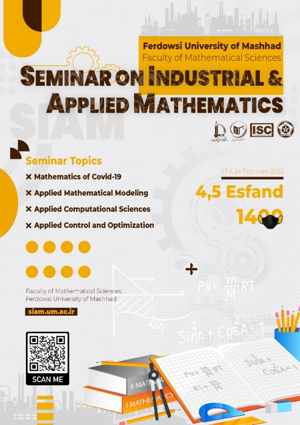

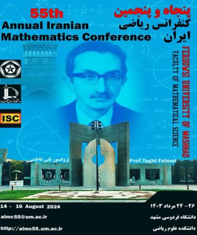

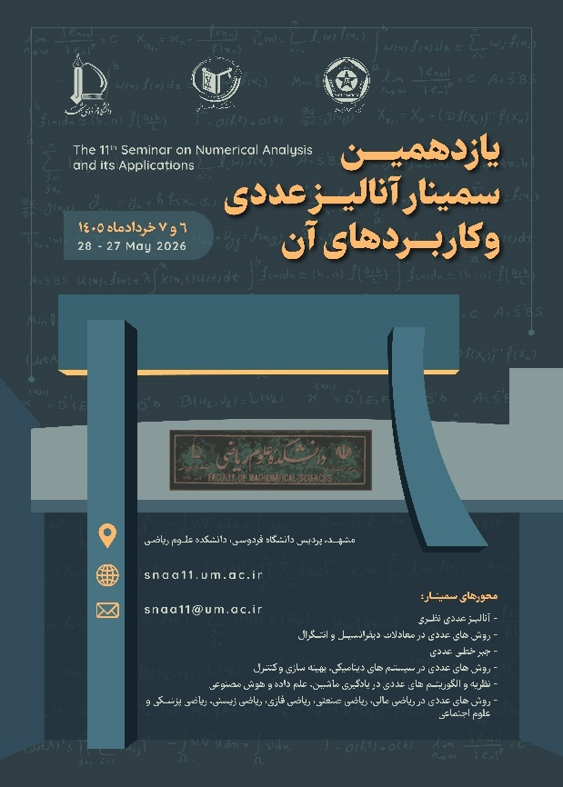

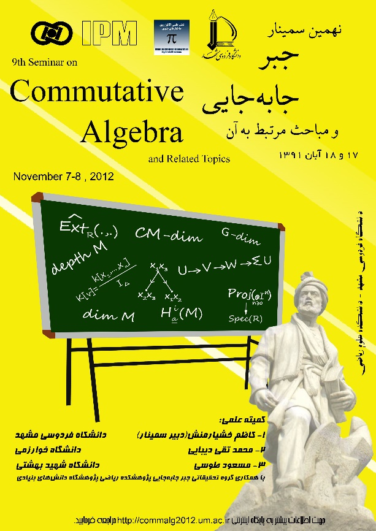

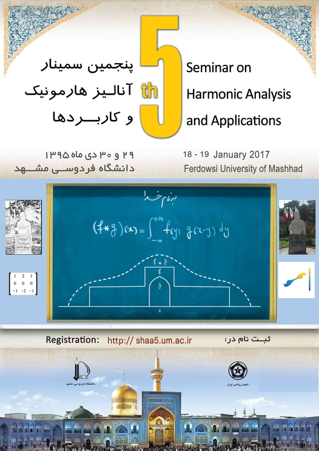

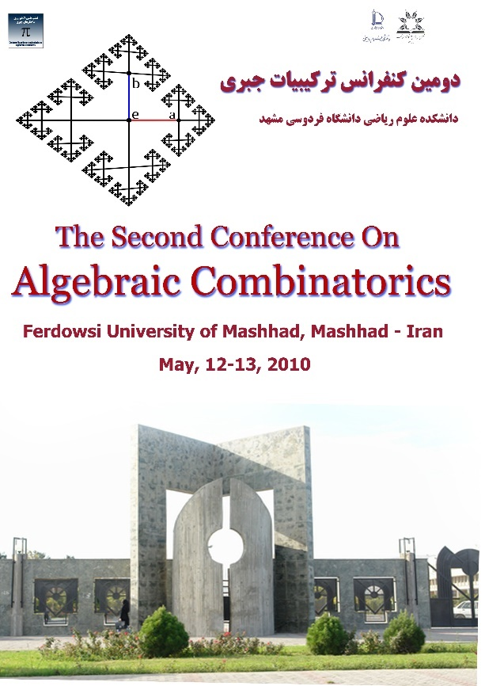

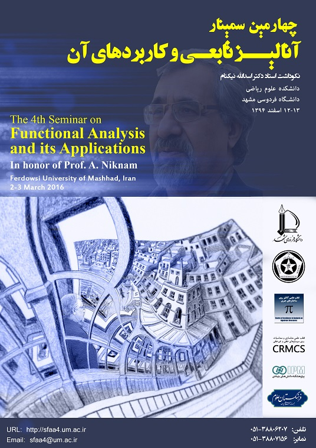

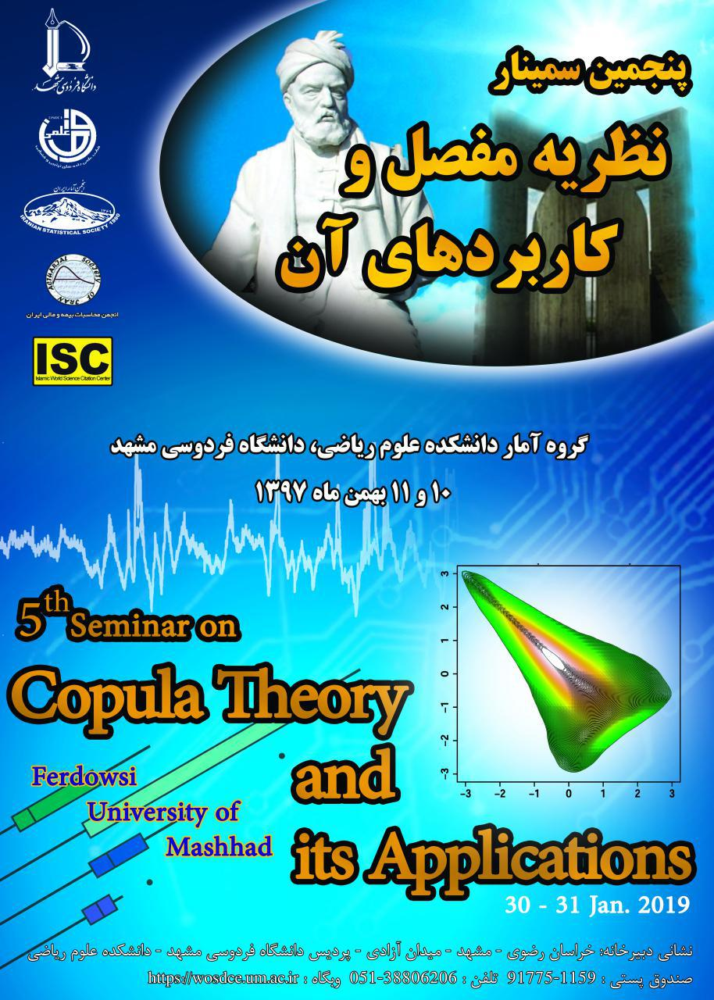

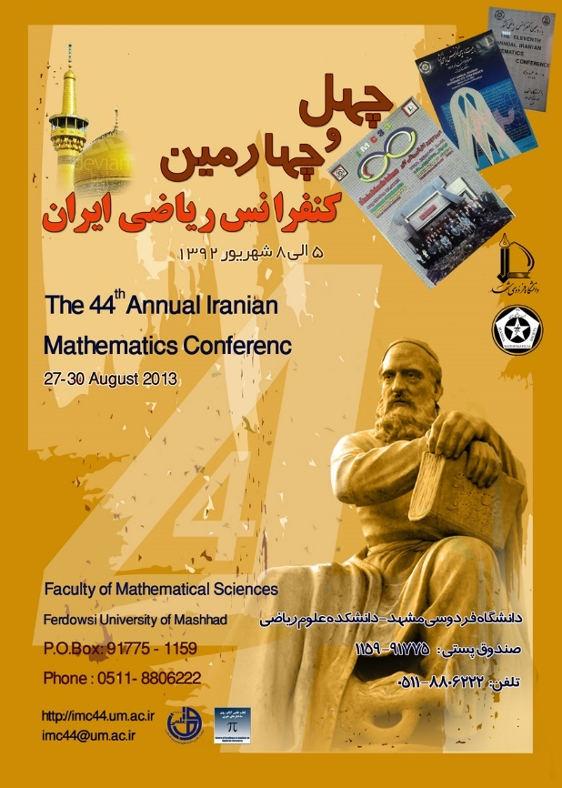

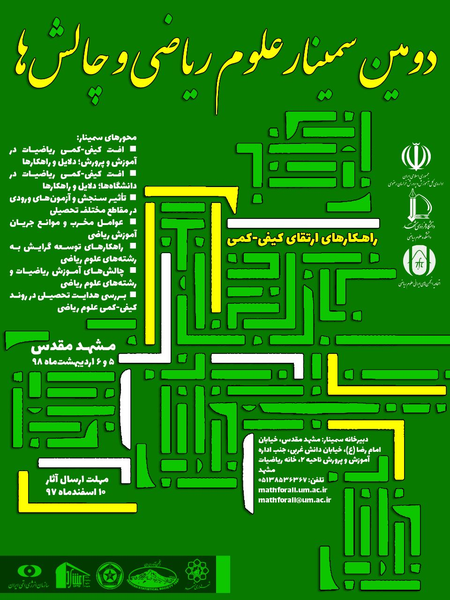

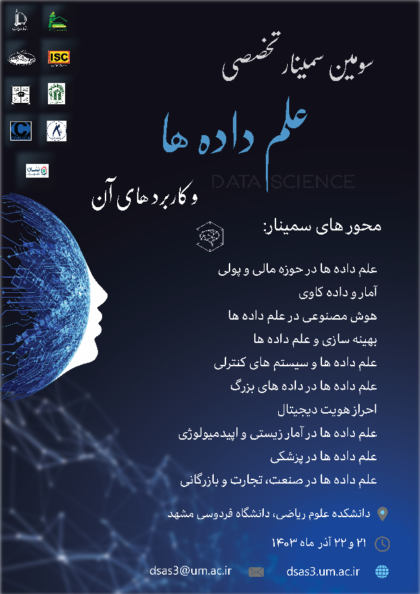

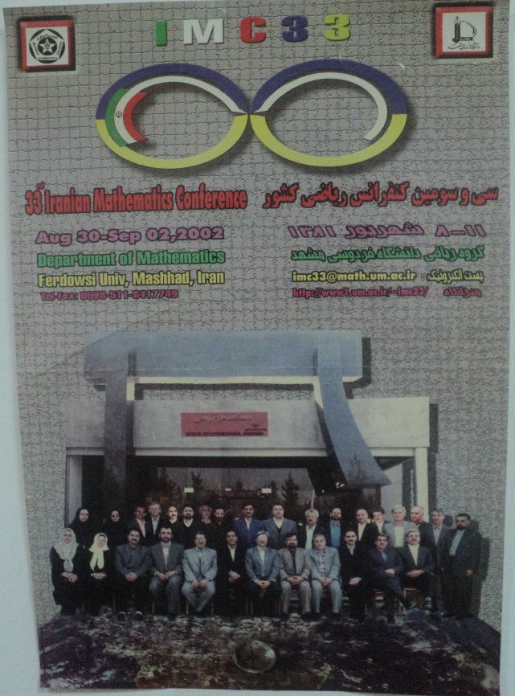

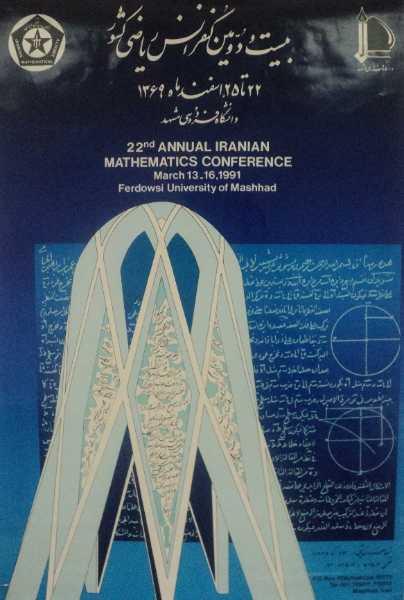

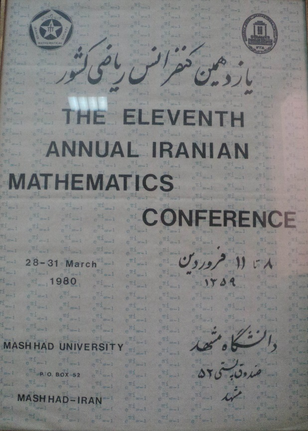

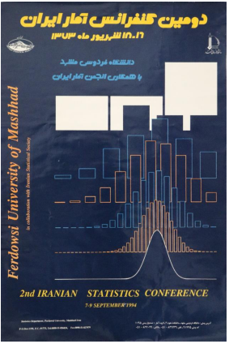

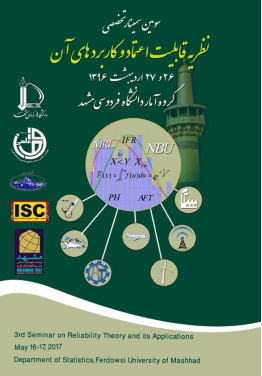

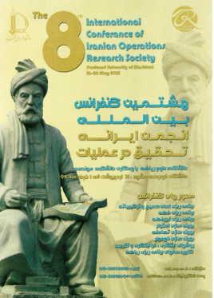

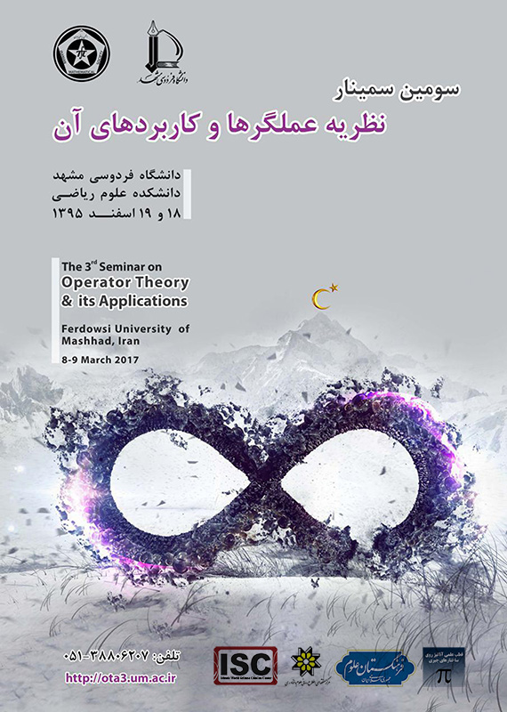

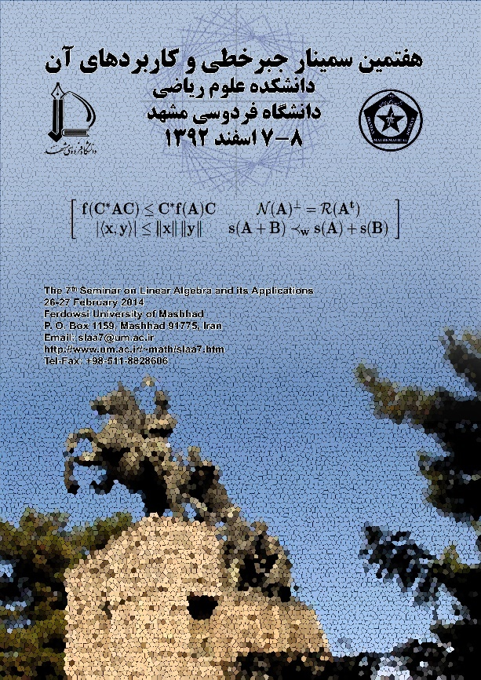

