# نکوداشت‌ها و بزرگداشت‌ها

| استاد پیشکسوت | تاریخ برگزاری |
|---|---|
| پروفسور تقی فاطمی | ۱۵ اردیبهشت ماه ۱۳۷۹ |
| دکتر ابوالقاسم بزرگ نیا | ۲۸ اردیبهشت ماه ۱۳۸۴ |
| دکتر غلامحسین شاهکار | ۳۰ دی ماه ۱۳۹۴ |
| دکتر اسدالله نیکنام | ۱۲ اسفند ماه ۱۳۹۴ |
| دکتر بهمن هنری | ۲۴ آذر ماه ۱۳۹۵ |
| دکتر محمدعلی پورعبدالله‌نژاد | ۲۹ دی ماه ۱۳۹۵ |
| دکتر علی وحیدیان کامیاد | ۲۰ مهر ماه ۱۳۹۶ |
| دکتر ناصررضا ارقامی | ۱۹ اردیبهشت ماه ۱۳۹۷ |
| دکتر حسن صادقی | ۲ آبان ماه ۱۳۹۷ |
| دکتر  حسنعلی آذرنوش | ۸ آبان ماه ۱۳۹۸ |
| دکتر فائزه توتونیان | ۱۳ دی ماه ۱۴۰۰ |
| دکتر شیرین حجازیان | ۲۱ اردیبهشت ماه ۱۴۰۱ |
| دکتر علی مشکانی | ۴ آبان ماه ۱۴۰۱ |
| دکتر حسینعلی نیرومند | ۳ آبان ماه ۱۴۰۲ |
| دکتر اصغر کرایه چیان | ۱۷ اردیبهشت ماه ۱۴۰۳ |
| دکتر طباطبایی | ۲ آبان ماه ۱۴۰۳ |
| دکتر محمدهادی فراهی | ۳ دی ماه ۱۴۰۳ |
| دکتر زهرا افشارنژاد | ۱۰ خرداد ماه ۱۴۰۴ |
| دکتر محمدرضا رجب زاده مقدم | ۹ مهر ماه ۱۴۰۴ |
| دکتر جعفر صابری نجفی | ۱۷ آذر ماه ۱۴۰۴ |

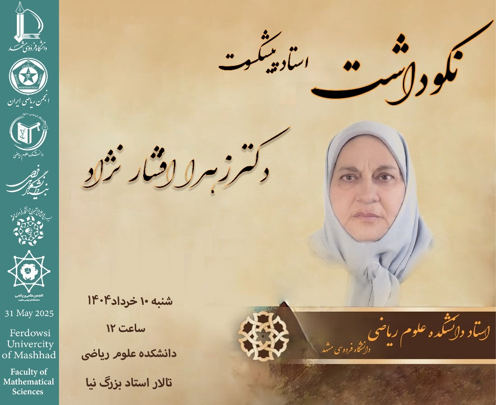

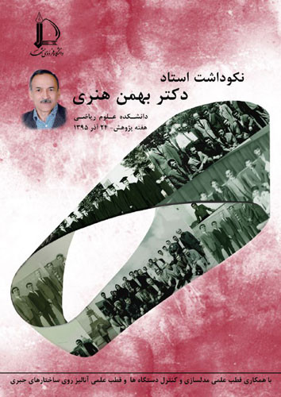

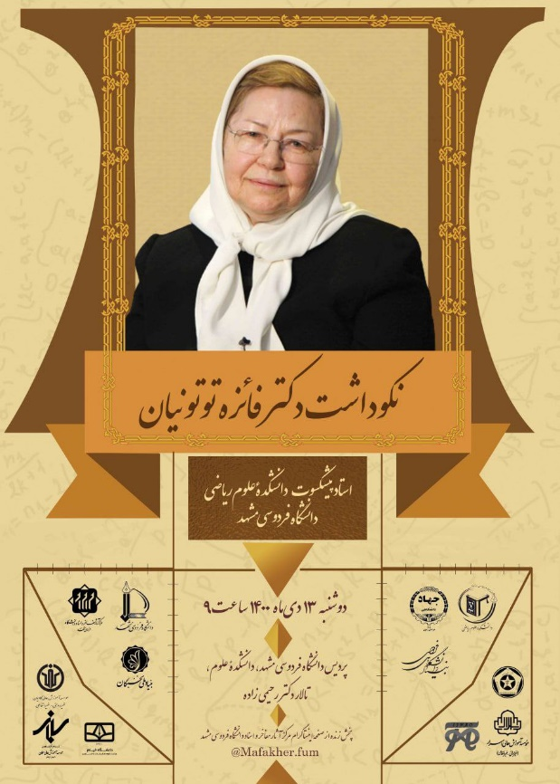

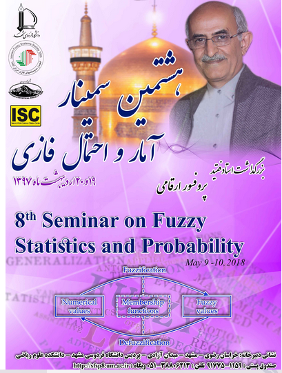

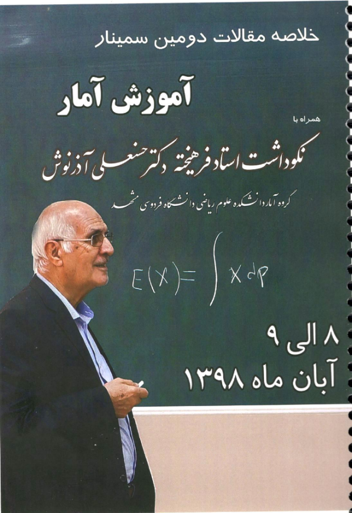

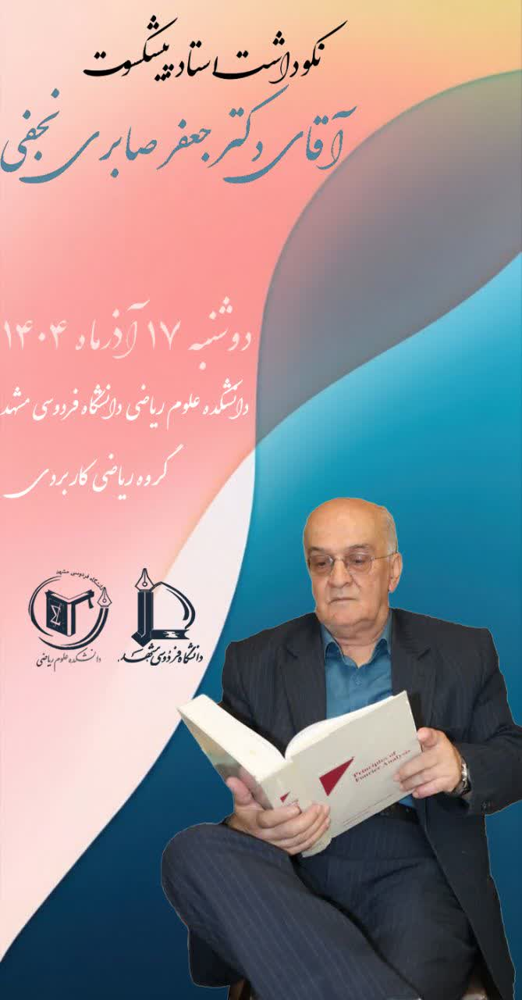

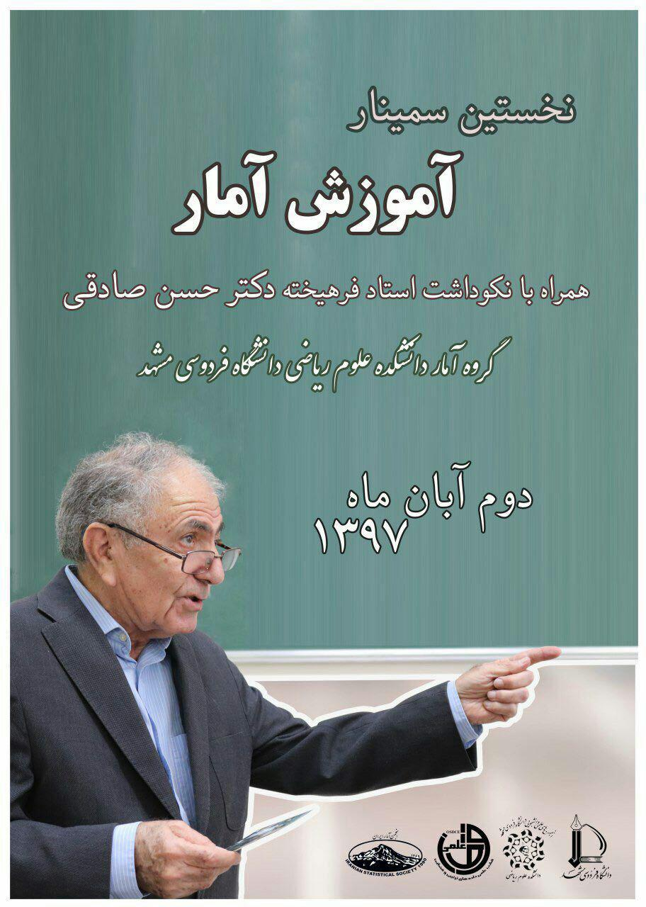

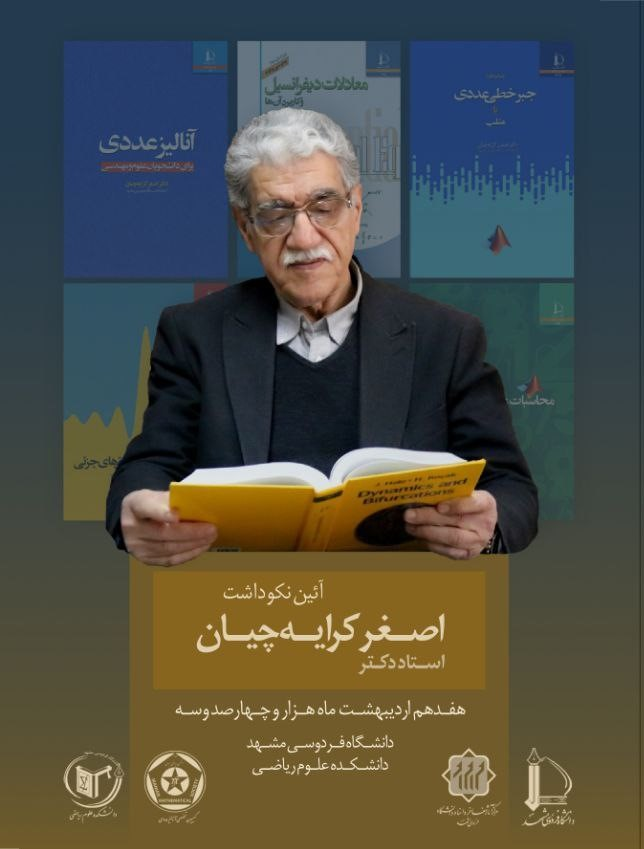

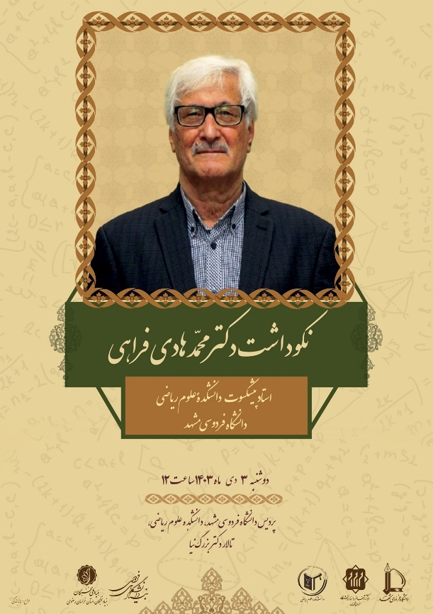

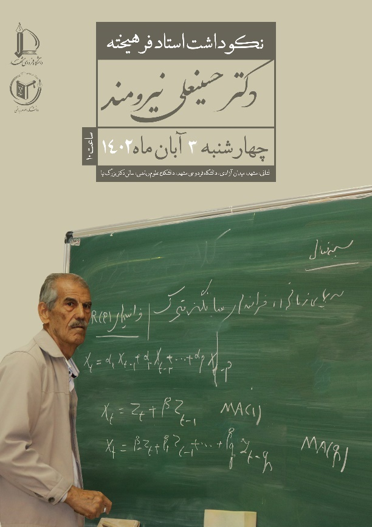

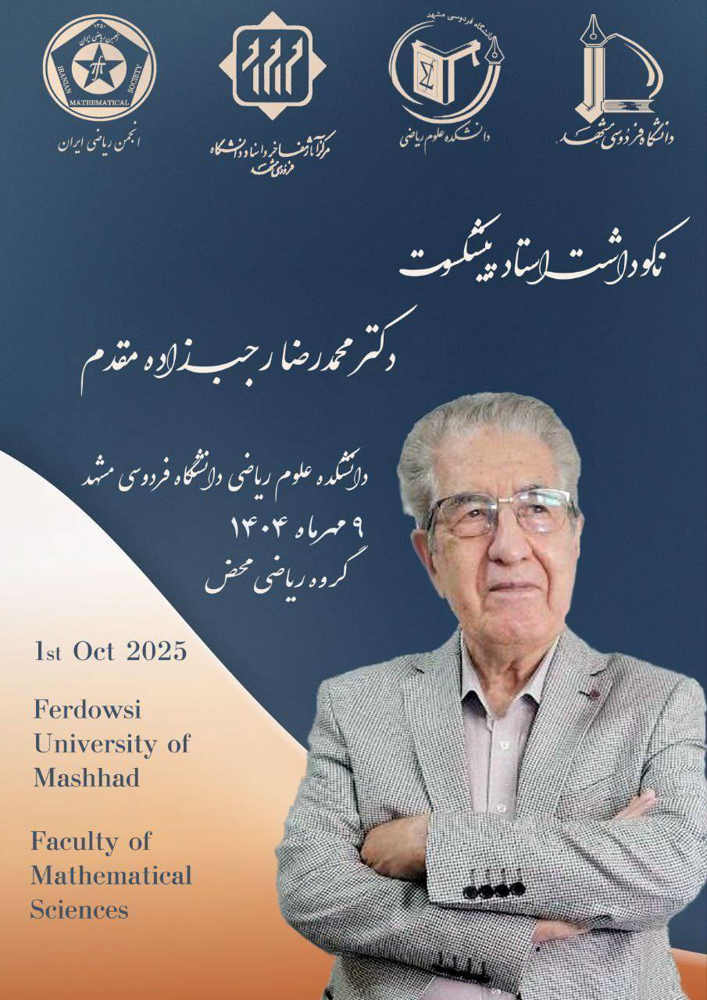
