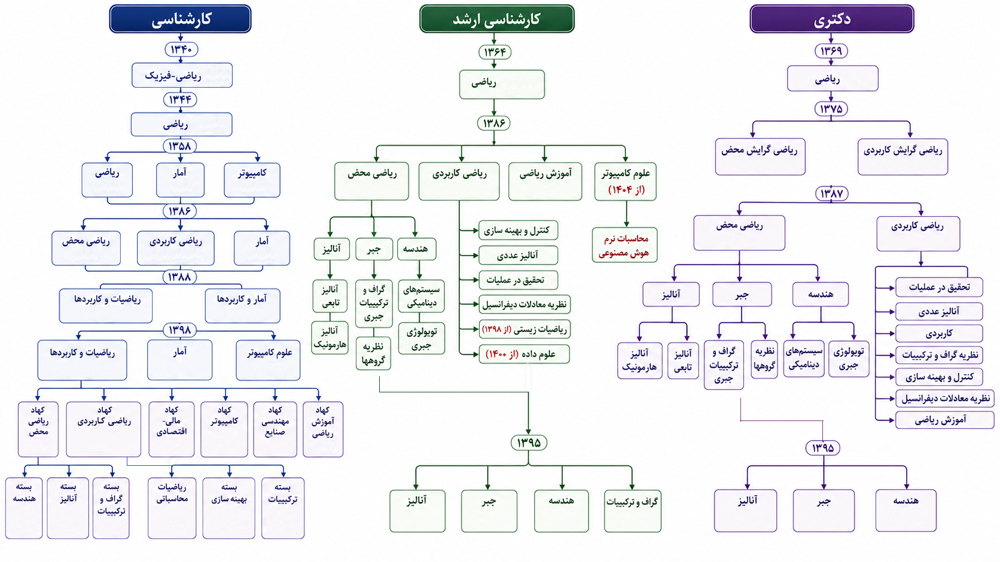
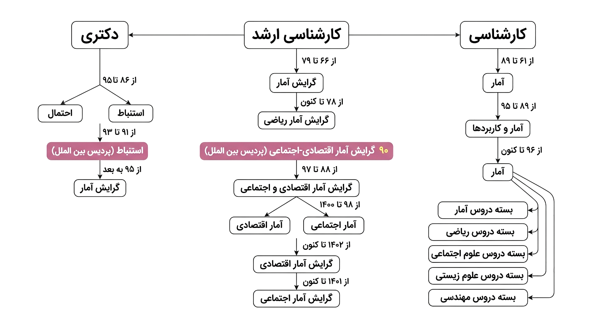
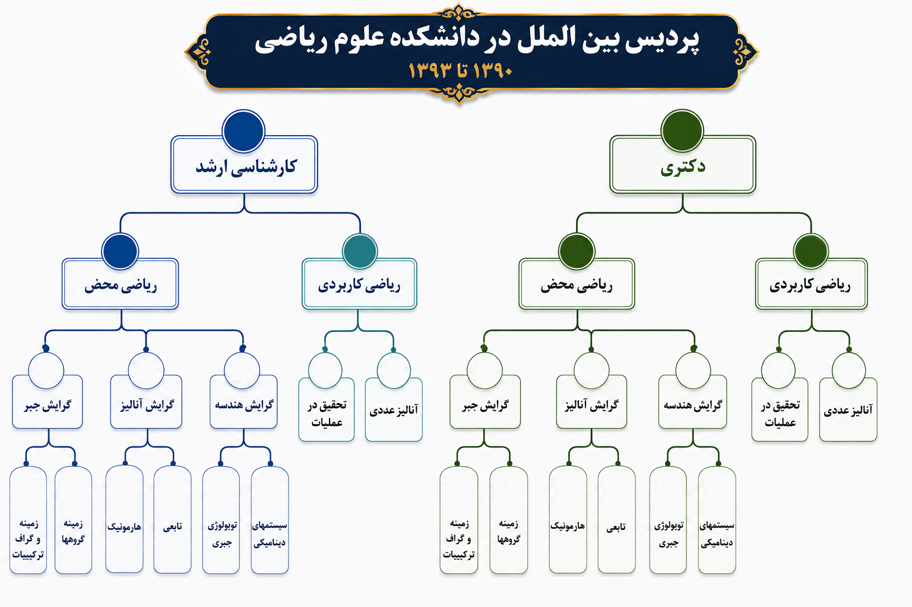

# ضمایم

## شهدای دانشکده

## آمار دانشجویان بین الملل جاری

​

| ردیف | رشته | مقطع | روزانه | روزانه | روزانه | نوبت دوم | نوبت دوم | نوبت دوم | جمع کل |
|---|---|---|---|---|---|---|---|---|---|
|  |  |  | زن | مرد | جمع | زن | مرد | جمع |  |
| ۱ | آموزش ریاضی | کارشناسی ارشد | ۱ | ۰ | ۱ | ۰ | ۰ | ۰ | ۱ |
| ۲ | ریاضی محض گرایش آنالیز | دکتری | ۱ | ۰ | ۱ | ۰ | ۰ | ۰ | ۱ |
| ۳ | آمار | کارشناسی | ۰ | ۰ | ۰ | ۲ | ۲ | ۴ | ۴ |
| ۴ | آمار ریاضی | دکتری | ۰ | ۰ | ۰ | ۰ | ۱ | ۱ | ۱ |
| ۵ | ریاضی کاربردی گرایش آنالیز عددی | کارشناسی ارشد | ۰ | ۰ | ۰ | ۲ | ۳ | ۵ | ۵ |
| ۶ | ریاضیات و کاربردها | کارشناسی | ۰ | ۰ | ۰ | ۳ | ۲ | ۵ | ۵ |
| ۷ | علوم کامپیوتر | کارشناسی | ۰ | ۰ | ۰ | ۰ | ۱ | ۱ | ۱ |
| ۸ | ریاضیات و کاربردها گرایش جبر | کارشناسی ارشد | ۰ | ۰ | ۰ | ۳ | ۷ | ۱۰ | ۱۰ |
| ۹ | ریاضی کاربردی گرایش تحقیق در عملیات (پژوهش محور) | دکتری | ۰ | ۰ | ۰ | ۰ | ۱ | ۱ | ۱ |
| ۱۰ | ریاضیات و کاربردها گرایش آنالیز | کارشناسی ارشد | ۰ | ۰ | ۰ | ۱ | ۰ | ۱ | ۱ |
| ۱۱ | ریاضیات و کاربردها گرایش گراف و ترکیبات | کارشناسی ارشد | ۰ | ۰ | ۰ | ۱ | ۰ | ۱ | ۱ |
| ۱۲ | ریاضی کاربردی (پژوهش محور) | دکتری | ۰ | ۰ | ۰ | ۳ | ۱ | ۴ | ۴ |
| ۱۳ | ریاضی گرایش زیر برنامه گراف و ترکیبیات | دکتری | ۰ | ۲ | ۲ | ۰ | ۰ | ۰ | ۲ |
| ۱۴ | ریاضی گرایش زیر برنامه آنالیز عددی (پژوهش محور) | دکتری | ۰ | ۰ | ۰ | ۰ | ۲ | ۲ | ۲ |
| ۱۵ | ریاضی کاربردی گرایش بهینه‌سازی (پژوهش محور) | دکتری | ۰ | ۰ | ۰ | ۰ | ۱ | ۱ | ۱ |
| ۱۶ | ریاضی گرایش هندسه_توپولوژی | دکتری | ۰ | ۰ | ۰ | ۰ | ۱ | ۱ | ۱ |
| ۱۷ | ریاضی گرایش جبر | دکتری | ۱ | ۰ | ۱ | ۰ | ۰ | ۰ | ۱ |
| ۱۸ | ریاضی گرایش آنالیز | دکتری | ۰ | ۰ | ۰ | ۱ | ۰ | ۱ | ۱ |
| جمع کل | جمع کل | جمع کل | ۳ | ۲ | ۵ | ۱۶ | ۲۲ | ۳۸ | ۴۳ |

## آمار دانشجویان دکتری جاری

| ردیف | رشته | مقطع | روزانه | روزانه | روزانه | نوبت دوم | نوبت دوم | نوبت دوم | جمع کل |
|---|---|---|---|---|---|---|---|---|---|
|  |  |  | زن | مرد | جمع | زن | مرد | جمع |  |
| ۱ | ریاضی کاربردی گرایش تحقیق در عملیات | دکتری | ۱ | ۱ | ۲ | ۰ | ۰ | ۰ | ۲ |
| ۲ | آموزش ریاضی | دکتری | ۳ | ۱ | ۴ | ۰ | ۰ | ۰ | ۴ |
| ۳ | ریاضی محض گرایش آنالیز | دکتری | ۱ | ۰ | ۱ | ۰ | ۰ | ۰ | ۱ |
| ۴ | آمار | دکتری | ۲۳ | ۵ | ۲۸ | ۰ | ۰ | ۰ | ۲۸ |
| ۵ | آمار ریاضی | دکتری | ۰ | ۰ | ۰ | ۰ | ۱ | ۱ | ۱ |
| ۶ | ریاضی کاربردی گرایش آنالیز عددی | دکتری | ۱ | ۲ | ۳ | ۰ | ۰ | ۰ | ۳ |
| ۷ | ریاضی کاربردی زمینه آنالیز عددی | دکتری | ۱ | ۰ | ۱ | ۰ | ۰ | ۰ | ۱ |
| ۸ | ریاضی محض گرایش آنالیز زمینه تابعی | دکتری | ۱ | ۰ | ۱ | ۰ | ۰ | ۰ | ۱ |
| ۹ | ریاضی محض گرایش هندسه (توپولوژی) | دکتری | ۰ | ۱ | ۱ | ۰ | ۰ | ۰ | ۱ |
| ۱۰ | ریاضی کاربردی گرایش تحقیق در عملیات (پژوهش محور) | دکتری | ۰ | ۰ | ۰ | ۰ | ۱ | ۱ | ۱ |
| ۱۱ | ریاضی کاربردی (پژوهش محور) | دکتری | ۰ | ۰ | ۰ | ۳ | ۱ | ۴ | ۴ |
| ۱۲ | ریاضی گرایش زیر برنامه گراف و ترکیبیات | دکتری | ۶ | ۶ | ۱۲ | ۱ | ۱ | ۲ | ۱۴ |
| ۱۳ | ریاضی گرایش زیر برنامه آنالیز عددی | دکتری | ۱ | ۲ | ۳ | ۰ | ۰ | ۰ | ۳ |
| ۱۴ | ریاضی گرایش زیر برنامه آنالیز عددی (پژوهش محور) | دکتری | ۰ | ۰ | ۰ | ۰ | ۲ | ۲ | ۲ |
| ۱۵ | ریاضی کاربردی گرایش بهینه‌سازی (پژوهش محور) | دکتری | ۰ | ۰ | ۰ | ۰ | ۱ | ۱ | ۱ |
| ۱۶ | ریاضی گرایش هندسه_توپولوژی | دکتری | ۱ | ۰ | ۱ | ۰ | ۱ | ۱ | ۲ |
| ۱۷ | ریاضی گرایش جبر | دکتری | ۸ | ۲ | ۱۰ | ۱ | ۱ | ۲ | ۱۲ |
| ۱۸ | ریاضی گرایش آنالیز | دکتری | ۵ | ۴ | ۹ | ۱ | ۰ | ۱ | ۱۰ |
| ۱۹ | ریاضی گرایش کاربردی | دکتری | ۱۳ | ۱ | ۱۴ | ۱ | ۰ | ۱ | ۱۵ |
| ۲۰ | ریاضی کاربردی زمینه تحقیق در عملیات | دکتری | ۰ | ۱ | ۱ | ۰ | ۰ | ۰ | ۱ |
| جمع کل دکتری | جمع کل دکتری | جمع کل دکتری | ۶۵ | ۲۶ | ۹۱ | ۷ | ۹ | ۱۶ | ۱۰۷ |

## آمار دانشجویان کارشناسی ارشد جاری

| ردیف | رشته | مقطع | روزانه | روزانه | روزانه | نوبت دوم | نوبت دوم | نوبت دوم | جمع کل |
|---|---|---|---|---|---|---|---|---|---|
|  |  |  | زن | مرد | جمع | زن | مرد | جمع |  |
| ۱ | آموزش ریاضی | ارشد | ۱ | ۱ | ۲ | ۰ | ۰ | ۰ | ۲ |
| ۲ | آمار ریاضی | ارشد | ۱۳ | ۳ | ۱۶ | ۳ | ۱ | ۴ | ۲۰ |
| ۳ | ریاضی کاربردی گرایش آنالیز عددی | ارشد | ۵ | ۱ | ۶ | ۲ | ۳ | ۵ | ۱۱ |
| ۴ | ریاضی کاربردی گرایش بهینه‌سازی | ارشد | ۶ | ۵ | ۱۱ | ۰ | ۰ | ۰ | ۱۱ |
| ۵ | ریاضی کاربردی گرایش ریاضیات زیستی | ارشد | ۸ | ۴ | ۱۲ | ۰ | ۰ | ۰ | ۱۲ |
| ۶ | آمار اجتماعی و اقتصادی | ارشد | ۱ | ۱ | ۲ | ۰ | ۰ | ۰ | ۲ |
| ۷ | ریاضیات و کاربردها گرایش هندسه (توپولوژی) | ارشد | ۰ | ۱ | ۱ | ۰ | ۰ | ۰ | ۱ |
| ۸ | ریاضیات و کاربردها گرایش جبر | ارشد | ۵ | ۲ | ۷ | ۴ | ۸ | ۱۲ | ۱۹ |
| ۹ | ریاضیات و کاربردها گرایش آنالیز | ارشد | ۸ | ۶ | ۱۴ | ۳ | ۰ | ۳ | ۱۷ |
| ۱۰ | ریاضیات و کاربردها گرایش گراف و ترکیبات | ارشد | ۰ | ۰ | ۰ | ۱ | ۱ | ۲ | ۲ |
| ۱۱ | ریاضی کاربردی گرایش علوم داده | ارشد | ۶ | ۸ | ۱۴ | ۰ | ۱ | ۱ | ۱۵ |
| ۱۲ | آمار اجتماعی | ارشد | ۴ | ۱ | ۵ | ۰ | ۰ | ۰ | ۵ |
| ۱۳ | آمار اقتصادی | ارشد | ۷ | ۵ | ۱۲ | ۰ | ۰ | ۰ | ۱۲ |
| ۱۴ | ریاضیات و کاربردها گرایش گراف و ترکیبیات | ارشد | ۱۰ | ۱۰ | ۲۰ | ۰ | ۰ | ۰ | ۲۰ |
| ۱۵ | ریاضیات و کاربردها گرایش هندسه و توپولوژی | ارشد | ۹ | ۵ | ۱۴ | ۰ | ۰ | ۰ | ۱۴ |
| ۱۶ | علوم کامپیوتر گرایش محاسبات نرم و هوش مصنوعی | ارشد | ۱ | ۵ | ۶ | ۰ | ۰ | ۰ | ۶ |
| جمع کل ارشد | جمع کل ارشد | جمع کل ارشد | ۸۴ | ۵۸ | ۱۴۲ | ۱۳ | ۱۴ | ۲۷ | ۱۶۹ |

## آمار دانشجویان کارشناسی جاری

| ردیف | رشته | مقطع | روزانه | روزانه | روزانه | نوبت دوم | نوبت دوم | نوبت دوم | جمع کل |
|---|---|---|---|---|---|---|---|---|---|
|  |  |  | زن | مرد | جمع | زن | مرد | جمع |  |
| ۱ | آمار | کارشناسی | ۱۱۱ | ۴۳ | ۱۵۴ | ۴۶ | ۱۴ | ۶۰ | ۲۱۴ |
| ۲ | ریاضیات و کاربردها | کارشناسی | ۱۷۹ | ۸۶ | ۲۶۵ | ۳۸ | ۲۳ | ۶۱ | ۳۲۶ |
| ۳ | علوم کامپیوتر | کارشناسی | ۶۱ | ۱۱۳ | ۱۷۴ | ۱۳ | ۲۱ | ۳۴ | ۲۰۸ |
| جمع کل کارشناسی | جمع کل کارشناسی | جمع کل کارشناسی | ۳۵۱ | ۲۴۲ | ۵۹۳ | ۹۷ | ۵۸ | ۱۵۵ | ۷۴۸ |

## درختواره گروه ریاضی

## درختواره گروه آمار

## درختواره پردیس بین‌الملل

